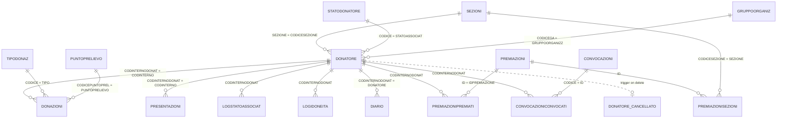

# AssoAvis 5: analisi tecnica dell'applicativo e del database

> **Scopo:** documentare come funziona AssoAvis 5, dove sono conservati i dati e quali tabelle servono, per progettare un nuovo gestionale che **riusi il database esistente**. Il database verrà poi integrato con i dati esportati dal nuovo portale regionale.
> **Approfondimenti:** (1) invio del **libro soci** (donatori e collaboratori) al **SIAN**; (2) gestione di **premiazioni e benemerenze**.
>
> Installazione analizzata: `C:\Program Files (x86)\Assoavis5`, sede **1529 – Comunale di Altopiano Asiago**.
> Data dell'analisi: **03/10/2026**.

---

## Indice

0. [Sintesi](#0-sintesi)
1. [Fonti e metodo](#1-fonti-e-metodo)
2. [Architettura dell'applicativo](#2-architettura-dellapplicativo)
3. [Dove sono i dati: mappa del database](#3-dove-sono-i-dati-mappa-del-database)
4. [Tabelle chiave in dettaglio](#4-tabelle-chiave-in-dettaglio)
5. [Libro soci e invio al SIAN](#5-libro-soci-e-invio-al-sian)
6. [Premiazioni e benemerenze](#6-premiazioni-e-benemerenze)
7. [Import dal SIT / portale regionale](#7-import-dal-sit--portale-regionale)
8. [Altri moduli (cenni)](#8-altri-moduli-cenni)
9. [Indicazioni per il nuovo gestionale](#9-indicazioni-per-il-nuovo-gestionale)
10. [Appendici](#10-appendici)

**Legenda di affidabilità:**
- **[C]** = certo: verificato su database, manuale o binari;
- **[D]** = dedotto: ricostruzione ragionata, da confermare.

---

## 0. Sintesi

- **Architettura**
  - AssoAvis 5 è un'applicazione desktop Windows client/server. Ha due eseguibili:
    - `Assoavis5.exe`: applicazione principale in Visual Basic 6;
    - `AssoAvisPlus.exe`: modulo .NET 4.5.2 per SIAN, mail e altre funzioni.
  - Entrambi si collegano a un database **SQL Server 2012 Express** locale (`(local)`, catalogo `ASSOAVIS`).
  - Nell'applicazione non c'è logica di business lato server, a parte alcune funzioni, viste e trigger SQL (vedi §2.4).
- **Dati**
  - Tutti i dati stanno nel database `ASSOAVIS`: 70 tabelle, **3.450 anagrafiche**, **32.177 donazioni** (1968 → 2026).
  - La tabella centrale è `DONATORE` (194 colonne). La chiave logica usata ovunque è `CODINTERNODONAT` (varchar 10).
  - Le foreign key dichiarate sono quasi assenti: le relazioni le gestisce l'applicazione.
- **Libro soci → SIAN**
  - Il SIAN è il *Sistema Informativo AVIS Nazionale* (`https://sian.avis.it`).
  - L'invio è implementato in `AssoAvisPlus.exe` tramite web service **SOAP 1.2** (`RegistroSoci.asmx`).
  - Si inviano i soci con stato associativo **3/4 (donatori → TIPOSOCIO 1)** e **5/6 (ex donatori e collaboratori → TIPOSOCIO 2)**, più i cessati dell'anno.
  - Ci sono due modalità di invio:
    - **totale** (Tipo 1), che sostituisce il registro dell'anno sul SIAN;
    - **incrementale** (Tipo 2), guidato dalle colonne `MODIFICATO_SIAN` / `INVIATO_SIAN`, che un trigger aggiorna a ogni modifica rilevante.
  - **Stato attuale [C]:** su questa installazione **l'invio non è mai stato fatto e non è attivabile così com'è**.
    - Lo schema DB è alla versione "7.0" e mancano alcune colonne e tabelle (vedi §5.11).
    - La sezione non è abilitata.
    - Nella build VB6 installata il bottone "Comunica libro soci" chiama una funzione vuota.
- **Benemerenze**
  - Ci sono 12 tipi di benemerenza: Rame … Oro con Diamante, più 4 per collaboratori e "Altra".
  - Ogni benemerenza è salvata come **coppia flag + data** su colonne di `DONATORE`, con nomi storici fuorvianti (es. `FLAGMEDBRONZO` = *Argento*).
  - Le premiazioni sono "procedure" (`PREMIAZIONI`) con fino a 12 regole: donazioni + anni, oppure sole donazioni; "Donne x2"; massimo donazioni per anno; stati ammessi.
  - Gli aventi diritto sono in `PREMIAZIONIPREMIATI`. Il calcolo avviene **lato client** (VB6).
  - L'**assegnazione è irreversibile**: scrive flag e data in `DONATORE`.
- **Per il nuovo gestionale**
  - Riusare il DB è fattibile, ma con alcuni accorgimenti (vedi §9):
    - rispettare la generazione dei codici (`SEQUENCENUMBERS`) e i trigger;
    - decidere se migrare lo schema alla 7.1, perché il SIAN la presuppone;
    - risolvere la decodifica dei gruppi sanguigni, che sono cifrati.

---

## 1. Fonti e metodo

| Fonte | Data / versione | Uso |
|---|---|---|
| Database `ASSOAVIS` su SQL Server 2012 Express (11.0.5058) locale | interrogato il 03/10/2026 (solo `SELECT`) | schema, conteggi, codifiche, trigger e procedure |
| Database `ASSOAVIS_PRIMA_IMPORT` | creato il 01/10/2026 alle 21:32 | copia di sicurezza fatta prima dell'import SIT del 01/10/2026 |
| `Manuali\Manuale.pdf` | **rev. 1.4.41 del 19/12/2023**, per AssoAvis 5.5.3.18 | funzionamento, premiazioni, import SIT, stati |
| `Assoavis5.exe` (VB6, v5.05.0003) | file del 19/11/2024 | analisi statica di stringhe, SQL incorporato, form |
| `AssoAvisPlus.exe` (VB.NET, v1.25.0127.1150) | file del 27/01/2025 | analisi statica via reflection e disassemblaggio IL: flusso SIAN completo |
| `AssoTab\VBTrasf.txt` (= tabella `CAMPITRASF`) | file del 13/05/2016 | **dizionario dati** dei campi di `DONATORE` (gruppo e descrizione) |
| `LogImportaSIT.txt` | 01/10/2026 | esempio di log dell'import SIT |
| `Assoavis.ini` | 03/10/2026 | stringa di connessione (i segreti non sono riportati) |

**Note sul metodo**
- Nessun dato personale è riportato in questo documento: solo schema, codifiche e conteggi aggregati.
- Le funzioni e le viste SQL del fornitore sono **cifrate** (`WITH ENCRYPTION`). Il loro comportamento è dedotto dal nome, dalla firma e dal manuale; non sono state decifrate.

---

## 2. Architettura dell'applicativo

### 2.1 Componenti installati

| File | Tecnologia | Ruolo |
|---|---|---|
| `Assoavis5.exe` | VB6 (ADO/OLE DB, provider `SQLNCLI11`) | gestionale principale: anagrafiche, donazioni, convocazioni, premiazioni, stampe, import SIT, configurazioni |
| `AssoAvisPlus.exe` | VB.NET, .NET Framework 4.5.2 (DLL incorporate: LibMeSIS, NPOI per Excel) | funzioni "moderne" lanciate da VB6 da riga di comando: **invio SIAN**, editor mail/OAuth2, test token, ecc. |
| `ToolsAvis.exe` / `ToolsAvis2012.exe` | VB6 | configurazione della connessione (`Assoavis.ini`), backup e ripristino, migrazione da MSDE a SQL 2012, amministrazione DB (manuale App. D) |
| `AssistenzaMeSISSupremo.exe` | — | teleassistenza del fornitore (Me.S.I.S.) |
| `Wordview\` | Word Viewer 1995 | anteprima delle lettere `.doc` |

**Comunicazione VB6 → AssoAvisPlus [C]**
- VB6 lancia `AssoAvisPlus.exe /F:<FUNZIONE> /SEZIONE:n /AMBIENTE:n …`.
- AssoAvisPlus risponde scrivendo il file `AssoAvisPlus.semaforo` nella cartella del programma ("OK" oppure "ERRORE: …").
- VB6 attende al massimo 10 secondi.

### 2.2 Configurazione (`Assoavis.ini`)

```ini
[Connessione]
Provider=SQLNCLI11
Initial Catalog=ASSOAVIS
Data Source=(local)
User ID=sa
Password=<cifrata>            ; l'applicativo si collega come sa
AssoAdminID=ASSO<sede>
AssoAdminPassword=<cifrata>
Codice sede=1529
Nome Sede=Comunale di Altopiano Asiago
[SIAN]                        ; ASSENTE in questa installazione
Postazione Abilitata=1        ; abilita l'invio automatico da questa postazione
Path Log=<file>               ; log dell'invio SIAN
Server Test=1                 ; usa gli endpoint di test
```

### 2.3 Cartelle di lavoro

| Cartella | Contenuto |
|---|---|
| `AssoTab\` | tabelle di inizializzazione (`VB*.txt`), stradari, modelli di stampa (`ModelliStampe.saa`), struttura DB cifrata (`Struttura.ass`) |
| `Esporta\` | modelli di export ed etichette (`.eaa`, `.rep`), `Report.csv` |
| `ExpPerSezioni\`, `ImpPerSezioni\Log` | trasferimento dati tra sedi |
| `Lettere\`, `~AllegatiMail\` | lettere e allegati mail |
| `Manuali\Manuale.pdf` | manuale utente |

### 2.4 Logica lato database

| Oggetto | Tipo | Leggibile | Funzione |
|---|---|---|---|
| `Donatore_Update` | trigger | sì | aggiorna `DONATORE.MODIFICATO_SIAN` quando cambiano campi rilevanti per il SIAN (§5.8) |
| `Donatore_Delete` | trigger | sì | copia l'anagrafica eliminata in `DONATORE_CANCELLATO`, per comunicare l'eliminazione al SIAN |
| `au_EliminaDonatore`, `au_EliminaDonatoriSezione` | stored procedure | sì | cancellazione a cascata "manuale" di tutte le tabelle figlie (non ci sono FK) |
| `au_SettaConvocazione`, `au_CancellaConvocazione`, `au_LetteraIdoneita` | stored procedure | sì | convocazioni e lettere di idoneità |
| `fgruppo`, `frh`, `fKell`, `fstatodon`, `fido`, `fTotaleDonazioni`, `fultimapremiazione`, `fPremiazione`, `fStatoDonAl`, `fn_DonatoriAttivi`, `fn_DonatoriIscritti` … (42 funzioni) | funzioni | **cifrate** | decodifiche e calcoli usati nei report (manuale App. B e C) |
| `vw_Donatore`, `vw_Donazioni1`, `vw_Convocati`, `vw_Presentazioni1`, `vw_PrimaUltimaDonazione` | viste | **cifrate** | viste di comodo per report |

> **Attenzione [C]:** `fgruppo`, `frh` e `fKell` richiedono un parametro `@PWD`. I valori dei gruppi sanguigni in `POPUPINTERNI` sono **cifrati** (`CRIPTATO=2`), quindi `DONATORE.AB0/RH/KELL` sono codici non decodificabili senza la chiave del fornitore (vedi §9.4).

---

## 3. Dove sono i dati: mappa del database

**Posizione fisica [C]**
- `C:\Program Files\Microsoft SQL Server\MSSQL11.MSSQLSERVER\MSSQL\DATA\ASSOAVIS_Data.mdf`
- `ASSOAVIS_Log.ldf`

**Caratteristiche generali**
- Un solo schema: `dbo`.
- Collation: `Latin1_General_CI_AS`, con alcune colonne di sistema in `_KS_WS`.
- **Nessun vincolo FK** tranne `STORESAMI → RICHESAMI`.

### 3.1 Tabelle per area funzionale (righe al 03/10/2026)

| Area | Tabelle (righe) |
|---|---|
| **Anagrafica soci** | `DONATORE` (3.450), `DONATORE_CANCELLATO` (5), `LOGSTATOASSOCIAT` (8.468), `LOGIDONEITA` (4.894), `DIARIO` (51.061), `DONATOREPP` (4), `FOTOGRAFIE` (0), `DOCUMENTI` (0), `LOGFILEIMPORT` (0), `LISTAATTESA` (0), `BOLOGNA_RECLUTAMENTO` (0) |
| **Donazioni** | `DONAZIONI` (32.177), `PRESENTAZIONI` (14), `TIPODONAZ` (11), `PUNTOPRELIEVO` (8), `DESTINAZIONISACCA` (0), `PRIMANOTA` (21) |
| **Premiazioni** | `PREMIAZIONI` (31), `PREMIAZIONIPREMIATI` (1.799), `PREMIAZIONISEZIONI` (31) |
| **Convocazioni / agenda** | `CONVOCAZIONI` (6), `CONVOCAZIONICONVOCATI` (12.834), `CONVOCAZIONIGIORNI` (1.776), `CONVOCAZIONISEZIONI` (1.471), `LOGCONVOCAZIONI` (268), `CFGCONVOCAZIONI` (2), `AGENDA` (96), `MACCHINE` (1), `AGENDAMARCHE_LOG` (0), `UTENTI_AGENDA_WEB` (0) |
| **Esami** | `TABELLAESAMI` (184), `STORICODATEESAMI` (22), `RICHESAMI` (0), `STORESAMI` (0), `PERSONALPROFILE` (6), `ELEMENTPROFILE` (0), `TESTGROUP` (15) |
| **Comunicazioni / stampe** | `MAIL` (13), `MAILLISTA` (43), `MAIL_ALLEGATI` (3), `STAMPE` (52), `ETICHETTE` (3), `ETICHETTE_ELEMENTI` (8) |
| **Organizzazione** | `SEZIONI` (1), `GRUPPOORGANIZ` (14), `AVISITALIA` (3.340, anagrafe delle sedi AVIS), `GRUPPIITALIA` (813), `AZIENDE` (0), `MEDICIDIBASE` (0) |
| **Codifiche / territorio** | `STATODONATORE` (15), `TIPOSOSPENSIONE` (4), `POPUPINTERNI` (202), `POPUP` (0), `COMUNI` (16.909), `COMUNICF` (14.019), `USL` (8.114), `STRADARIO` (0) |
| **Sistema** | `UTENTI` (4), `PARAMETRI` (255), `SEQUENCENUMBERS` (24), `SEMAFORI` (100), `ACCESSIDB` (1), `AMBIENTE` (0), `FUNZIONI` (35), `RICERCHE` (33), `RICERCHESEMPLICI` (3), `CAMPITRASF` (189), `CAMPIESPORTAZIONE` (0), `CONFIGURAESPORT` (1), `EXTERNALPROC` (11) |

### 3.2 Relazioni principali (logiche, non dichiarate)



### 3.3 Chiavi e generazione dei codici [C]

- **`DONATORE.IDDONATORE`** (int identity) è la PK fisica.
- **`DONATORE.CODINTERNODONAT`** (varchar 10, indice univoco `IX_DONATORE`) è la **chiave logica** usata da tutte le tabelle figlie.
  - Formato: **6 cifre progressive + 4 cifre del codice sede**, es. `000200` + `1529`.
- **`LOGSTATOASSOCIAT.CODICELOG`** e `LOGIDONEITA.CODICELOG` hanno formato **codice sede + 6 cifre progressive**, es. `1529` + `008588`.
- **`SEQUENCENUMBERS(FILE, RSN)`** è il generatore applicativo dei progressivi, con una riga per contatore.
  - Esempi: `[DONATORE]CODINTERNODONAT`, `[DONATORE]TESSERA_1529`, `[LOGSTATOASSOCIAT]ID`, `[LOGIDONEITA]ID`, `[DIARIO]PROGRESSIVO`, `[PREMIAZIONI]ID`, `[CONVOCAZIONI]CODICE`.
  - **Un nuovo gestionale che scrive sullo stesso DB deve usare (e incrementare in transazione) questi contatori.**
- **Lock applicativo**: il campo `BLOCCATODA` (su `DONATORE`, `PREMIAZIONI`, `LISTAATTESA`) e la tabella `SEMAFORI` implementano un "record bloccato da utente X".

---

## 4. Tabelle chiave in dettaglio

### 4.1 `DONATORE` (anagrafica socio, 194 colonne)

Il dizionario ufficiale dei campi è in `CAMPITRASF` (o `AssoTab\VBTrasf.txt`). Qui sotto i campi raggruppati.

| Gruppo | Colonne principali |
|---|---|
| Identificazione | `IDDONATORE`, `CODINTERNODONAT`, `TESSERA` (tessera AVIS), `CODICEDONATORE` (**codice Centro Trasfusionale**, chiave dell'import SIT), `CODICEREG` (codice regionale donatore), `TESSERASANITARI`, `SEZIONE`, `GRUPPOORGANIZZ` |
| Anagrafica | `TITOLO`, `COGNOMEENOME`, `SOLOCOGNOME`, `SOLONOME`, `COGNOMEDASPOSAT`, `SESSO` (M/F), `DATADINASCITA`, `LUOGONASCITA`, `PROVDINASCITA`, `CODCOMUNENASC`, `CODICEFISCALE`, `STATOCIVILE`, `DOCUMENTO_TIPO/NUMERO/SCADENZA` |
| Contatti | `RES*` (residenza: indirizzo, CAP, città, prov., ISTAT, località, tel.), `DOM*` (domicilio), `DOMRESUGUALI`, `CELLULARE`, `EMAIL`, `FERMOPOSTA`, `LAV*` |
| Dati statistici | `PROFESSIONE`, `RAMOATTIVITA`, `OCCUPAZIONE`, `TITOLOSTUDIO` (codici in `POPUPINTERNI`) |
| **Stato associativo** | `STATOASSOCIAT` (→ `STATODONATORE`), `DATAPRIMAISCR`, `SEDEPRIMAISCR`, `TRASFERITODA`/`TRASFDADATA`, `TRASFERITOA`/`TRASFADATA`, `CANCELLADEFIN` (data di cancellazione), `MOTIVOCANCELL`, `TESSERATO`, `TESSERASTAMPATA`, `CARICASOCIALE`, `ALTRACARICA`, `COMMISSIONE1..9`, `ISCRAIDO`, `ISCRADMO`, `LEGGEPRIVACY` |
| **Benemerenze** | 12 coppie `FLAG*`/`DATA*` (vedi §6.1) + `NOBENEM` (non desidera benemerenze) |
| Idoneità | `IDONEITA` (1 Idoneo, 2 Sosp. definitivo, 3 Sosp. tempo indet., 4 Sosp. fino al, 5 Autosospeso), `DATAINIZIOSTATO`, `DATAFINESTATO`, `CODICELOGIDO`, `DETTAGLIOSOSP`, `NOTAIDONEITA` |
| Dati trasfusionali | `AB0`, `RH`, `KELL` (codici cifrati, §2.4), `INTERVALLO*` (salasso/aferesi), `ULTIMOCHECKU`, `ULTIMOESACONTR`, `ULTIMOURINE/ECG/RX`, `FLAGALLERGIA`, disponibilità (`SANGUEINTERO`, `PLASMAFERESI`, `PLTAFERESI`, …), preferenze giorni e mesi |
| **Contatori donazioni (denormalizzati)** | `TOTALEDONAZIONI`, `TOTALESI`, `TOTALEAFERESI`, `DONAZANNO`, `AFERESIANNO`, `DONAZIONIPREGR`, `DONAZIONIPREGRDOPO2004`, `AFERESIPREGRES`, `ULTIMDONAZIONE`, `ULTIMAAFERESI`, `PROSSDONAZIONE`, `PROSSAFERESI`, `PERMETTI4DONAZIONI` |
| Convocazioni | `CONVOCATO`, `CODCONVOCAZION`, `TIPODONAZIONE`, `DATACONVPREN`, `NONPRESENTATO`, `NONCONVOCARE`, `CODICECRMARCHE`, `TIPOPRENMARCHE` |
| **SIAN** | `MODIFICATO_SIAN`, `INVIATO_SIAN` (esistono); `SEMAFORO_SIAN` (**manca**, §5.11) |
| Varie | `LIBERO0..11`, `TESTOLIBERO1/2`, `MEMODON`, `MEMOCRYPTO` (nota medica cifrata), `BLOCCATODA`, `IMPORTATO`, `TRASFERITO`, `DATANUOVAANAGRAFICA` |

> I contatori sono **ridondanti** rispetto a `DONAZIONI` e vengono ricalcolati dal bottone "Aggiorna" (anche a inizio anno). Il nuovo gestionale deve ricalcolarli, oppure trattarli come cache.

### 4.2 `STATODONATORE` (stati associativi)

| Codice | Descrizione | Nel libro soci SIAN |
|---|---|---|
| 1 | Attesa Idoneità | no |
| 2 | Idoneo Aspirante Donatore | no |
| **3** | **Socio Prima Donazione** | **sì → TIPOSOCIO 1 (donatore)** |
| **4** | **Socio Donatore** | **sì → TIPOSOCIO 1 (donatore)** |
| **5** | **Socio Ex Donatore** | **sì → TIPOSOCIO 2 (non donatore)** |
| **6** | **Socio Collaboratore** | **sì → TIPOSOCIO 2 (non donatore)** |
| 7 | Affiliato Onorario | no |
| 8 | Affiliato Sostenitore | no |
| 9 | Ex Socio | solo come cessato nell'anno |
| 10 | Non Socio | no |
| 11–14, 30 | Autorità politiche, Autorità religiose, Sponsor, Ripresentato, Deceduto | no (stati aggiunti per i "non soci") |

**Distribuzione attuale di `DONATORE.STATOASSOCIAT`:**
- 4 = 534; 3 = 38; 5 = 7; 6 = 6 (totale soci 3–6: **585**);
- 9 = 1.952; 10 = 779; 7 = 85; altri < 20.

### 4.3 `LOGSTATOASSOCIAT` (storico stati associativi), fondamentale per il libro soci

Colonne (schema "7.0"): `CODICELOG` (PK), `CODINTERNODONAT`, `VECCHIOSTATO`, `NUOVOSTATO`, `DATACAMBIOSTATO`, `DATACHIUSURA`, `UTENTE`.

- **Regole del manuale [C]** (pp. 63-64, 145):
  - ogni cambio di stato apre un periodo; il periodo precedente si chiude con `DATACHIUSURA`;
  - non sono ammessi due stati nello stesso giorno;
  - lo storico è correggibile "per allineare il registro dei soci effettivi".
- **Uso:**
  - è la base di "Registro dei Donatori", "Riepilogo tesserati", "Schede dati associativi" e dell'**estrazione SIAN** (stato alla data del 31/12);
  - è usata anche dalla funzione `fStatoDonAl(cod, 'gg/mm/aaaa', campo)`.
- **Schema 7.1 (atteso dal SIAN, assente qui):** aggiunge `SEZIONE`, `PROGRESSIVOISCRIZIONE`, `DATAISCRIZIONE`, `DATACANCELLAZIONE`, `ISTRASFERITOA`, `IDMOTIVOCANCELLAZIONE`, `TESSERA`.

### 4.4 `DONAZIONI`

**Colonne**
- PK `(CODINTERNO, DATADON)`: una sola donazione per giorno per donatore;
- `TIPO` → `TIPODONAZ`, `PUNTOPRELIEVO`, `TIPORIMBORSO`, `SEZIONE`, `CODICESACCA`, `DESTINAZIONESACCA`, `DONAZIONEINTERROTTA`, `ESAMICOMPLETI`, `NOTEDONAZIONE`, campi `LIBERO*`.

**Codici di `TIPODONAZ`:**
- 1 SI Sangue intero;
- 2 PL Plasmaferesi;
- 3 PP Plasmapiastrinoaferesi;
- 4 PI Piastrinoaferesi;
- 5 LE Leucoaferesi;
- 6 CS Cellule staminali;
- 7 AM Aferesi multipla;
- 8 EA Eritroplasmaferesi;
- 9 EP Eritropiastrinoaferesi;
- 10 DP Doppia piastrinoaferesi;
- 11 XX Solo presentazione.

**Distribuzione:**
- SI 27.687; PL 4.469; altri 21;
- negli ultimi anni: 2022 = 860, 2023 = 859, 2024 = 728, 2025 = 788, 2026 (fino al 21/09) = 523.

### 4.5 `DONATORE_CANCELLATO`

- Viene popolata dal trigger `Donatore_Delete` con i campi anagrafici essenziali, `STATOASSOCIAT`, `SEZIONE` e `DATA_CANCELLAZIONE`.
- La colonna `INVIATO_SIAN` segnala se l'eliminazione è già stata comunicata.
- Contiene 5 righe, nessuna inviata.

### 4.6 `SEZIONI` (sedi gestite)

| Colonne | Contenuto |
|---|---|
| `CODICESEZIONE` | codice della sede (1529) |
| `NOMESEZIONE` | denominazione |
| indirizzo, `CODFISC`, `PARTIVA`, … | dati anagrafici della sede |
| `NUMERAZAUTO` | numerazione automatica delle tessere |
| `CODICEHOST` | codice della sede nei sistemi esterni |
| `DATA_ATTIVAZIONE_SIAN` | data di abilitazione della sede all'invio SIAN |
| `DATA_ULTIMO_INVIO_SIAN_TIPO1` | data dell'ultimo invio totale |
| `TOKEN_SIAN`, `ANNO_REGISTRO_CORRENTE_SIAN`, `ERRORE_COMUNICAZIONE_SIAN` | **mancanti** (§5.11) |

### 4.7 `POPUPINTERNI` (codifiche interne)

Struttura: `IDTIPO`, `TIPO`, `INDICE` (= codice salvato nelle tabelle), `POSIZIONE`, `VALORE`, `UNICODE`, `ISBTCODE`, `CRIPTATO`.

| IDTIPO | Codifica |
|---|---|
| 4 / 5 / 6 | AB0 / Rh / Kell (**valori cifrati**) |
| 7–16 | esiti esami e antigeni |
| 17 | Assenti/Presenti |
| 100 / 101 / 102 / 103 / 104 | Condizione non occupazionale / Titolo di studio / Professione / Ramo di attività / Stato civile |
| 105 | Idoneità |
| 106 | Cariche sociali |
| **109** | **Benemerenze**: `UNICODE` contiene il **nome della colonna flag** e `ISBTCODE` la **colonna data** in `DONATORE` (§6.1) |
| 110 / 111 / 200 | SMTP, OAuth2, tipi di allegati |

### 4.8 `PARAMETRI`

- Coppie `ID`/`VALORE`; `PARAMETRO` (il nome) è sempre NULL e `IDAMBIENTE` vale 0. Il significato degli ID è nel codice.
- Parametri rilevanti:

| ID | Significato | Valore |
|---|---|---|
| 163 | stati associativi automatici in base al numero di donazioni | 1 |
| 232 | `par_AbilitaSian` | 0 |
| 238 | lucchetto invio SIAN tra postazioni | assente |
| 239 | URL alternativo del web service SIAN | assente |

---

## 5. Libro soci e invio al SIAN

### 5.1 Cosa viene comunicato

- Il **libro soci / registro soci** della sede, **per anno di riferimento**.
- **Soci al 31/12 dell'anno** con stato 3, 4, 5 o 6:
  - **TIPOSOCIO = 1 "Donatore"**: stati 3 e 4;
  - **TIPOSOCIO = 2 "Non donatore"**: stati 5 (ex donatore) e 6 (**collaboratore**).
- **Soci cessati nell'anno**: con data e causa di cessazione. Come tipo socio si usa l'ultimo stato da socio, preso dal log.
- Solo nell'invio incrementale, **record da eliminare**:
  - anagrafiche modificate che non sono più soci;
  - anagrafiche cancellate fisicamente (da `DONATORE_CANCELLATO`).
- **Non** si inviano: donazioni, gruppo sanguigno, idoneità, benemerenze [C].
- **Volumi stimati sul DB attuale [C]:** per l'anno 2025, **517** soci attivi al 31/12 e **74** cessati nell'anno, cioè circa 591 record per un invio totale.

### 5.2 Architettura e modalità di invio [C]

```
Assoavis5.exe (VB6)                                 AssoAvisPlus.exe (.NET)
 Configurazioni > scheda "Sian"
  ├─ [x] Abilita questa postazione  ──► INI [SIAN] Postazione Abilitata=1
  ├─ lista sezioni: abilita/disabilita ──► SEZIONI.DATA_ATTIVAZIONE_SIAN = GetDate()/NULL
  └─ [Comunica libro soci] ─ ─ (in questa build: funzione vuota) ─ ─►  /F:SIANREGISTROSOCIWND /SEZIONE:n
                                                                      /F:SIANREGISTROSOCI   (automatico)
                                                                      /F:SIANREGISTROSOCIMANUALE (da Excel)
                                                                      /F:TESTATOKENSIAN, /F:SIANALLINEAANNO
                                                                                │ SOAP 1.2 / HTTPS
                                                                                ▼
                                                        https://sian.avis.it/sianws/RegistroSoci.asmx
                                                        https://sian.avis.it/SIANAUTH/auth.aspx
```

| `/F:` | Cosa fa | Autenticazione | Aggiorna il DB? |
|---|---|---|---|
| `SIANREGISTROSOCI` | invio **automatico** senza interfaccia, per **tutte** le sezioni abilitate; sceglie da solo tra Tipo 1 e Tipo 2 | token di servizio in `SEZIONI.TOKEN_SIAN` | **sì**: semafori, `INVIATO_SIAN`, data ultimo T1, errori |
| `SIANREGISTROSOCIWND` | finestra "Riepilogo dati per l'invio al SIAN": estrazione dell'anno corrente, controlli, invio **totale** con conferma | login interattivo | **no** |
| `SIANREGISTROSOCIMANUALE` | come WND, ma legge un **Excel** con il tracciato a 24 colonne (anche per più sedi): è la modalità "SianUploader" | login interattivo | no |
| `TESTATOKENSIAN` | verifica il token con `IsAlive` | token di servizio | no |
| `SIANALLINEAANNO` | rilegge dal server l'anno del registro | token di servizio | `ANNO_REGISTRO_CORRENTE_SIAN` |

### 5.3 Protocollo (web service SOAP 1.2, namespace `http://sian.mesis.it/`) [C]

| Ambiente | WS | AUTH |
|---|---|---|
| produzione | `https://sian.avis.it/sianws/` | `https://sian.avis.it/SIANAUTH/` |
| test | `https://sian.avis.it/test/sianwstest/` | `https://sian.avis.it/test/SIANAUTH/` |

| Operazione (`RegistroSoci.asmx`) | Richiesta | Risposta |
|---|---|---|
| `InvioListaTesserati` (Tipo 1, a pacchetti di circa 1 MB) | `<Registro>`: Sede, AnnoRiferimento, IDInvio, Tipo (1/2), Token, XML, Pacchetto (da 1), Totale, Programma | `{Errore, IDUnivocoInvio}`. L'ID del primo pacchetto va ripassato come `IDInvio` nei pacchetti successivi |
| `InvioSingoloTesserato` (Tipo 2, un socio per chiamata) | `<SingoloSocio>`: Sede, AnnoRiferimento, Token, XML, Programma | `{Errore, TotaleErrori, DataAnalisi, ListaErroriImportazione[{Critico, Errori[], XML}]}` |
| `IsAlive` | `<Alive>`: Sede, Token | `{DataServer, Errore, AnnoRegistro}` |
| `InvioLogTrace` (`LogTrace.asmx`) | Sede, Anno, RecordTotSoci, RecordNuoviIscritti, RecordCancellati, RecordCorretti, RecordErrori, Versione | `{Errore, VersioneServer}` |

**Contenuto del campo `XML`**
- Generato con `DataSet.WriteXml`.
- Struttura: `<ListaTesserati><Tesserato><COGNOME>…</COGNOME>…</Tesserato>…</ListaTesserati>`.
- I campi NULL vengono **omessi**.
- Le date sono in formato ISO con offset, es. `1980-01-01T00:00:00+01:00`.

**Parametri di rete:** timeout 30 s; TLS 1.0, 1.1 e 1.2 abilitati.

### 5.4 Autenticazione [C]

- **Login interattivo (`frmLoginSian`)**
  - **Utente e password SIAN**
    - Chiamata: `POST {AUTH}/auth.aspx` con corpo JSON `{"Applicativo":"AssoAvisPlus","Azione":"auth","Utente":…,"Password":…,"Funzione":"login1"}`.
    - Risposta: `{"Errore":0,"Token":"…"}`.
  - **"Utilizza credenziali dominio @AVIS"**
    - Login OAuth2 Microsoft Entra ID (authorization code, scope `openid offline_access`).
    - Poi `auth.aspx` con `"Funzione":"login2"` e `"TokenAD":<access token>`.
- **Formato del token**
  - È un JWT, eventualmente nella forma `"$SIAN$" + Base64(GZip(JWT))`.
  - Il payload contiene: utente (CF, nome, cognome), `Scadenza`, `Modalita` (es. `"Service"`), **`SezioniAbilitate`** (lista delle sedi).
- **Invio automatico:** usa un **token di servizio** salvato in `SEZIONI.TOKEN_SIAN`. AssoAvisPlus lo legge ma non lo scrive mai. Lo genera il Presidente della sede sul portale SIAN, in *Gestione Utente* → "Genera token per cooperazione applicativa" (verificato il 02/11/2026, README M5).
- **Codici di errore del login:**
  - -20 non autorizzato; -22 parametri errati; -999 applicativo non autorizzato;
  - da -1000 a -1010 problemi dell'account;
  - -4000/-4001/-4002 token scaduto / non valido / non verificabile;
  - -6000 errore SQL; -7000 dati modificati da un altro utente.

### 5.5 Tracciato del socio (24 colonne del "tracciato ufficiale") [C]

| # | Campo SIAN | Origine nel DB (schema 7.0) | Regole |
|---|---|---|---|
| 1 | `CODICESEDE` | `DONATORE.SEZIONE` | deve essere unico nel lotto |
| 2 | `ANNORIFERIMENTO` | anno di estrazione | deve essere unico nel lotto |
| 3 | `UNIVOCOAVIS` | `CODINTERNODONAT` (nella 7.1: `CODINTERNODONAT_<progressivo iscrizione>`) | **chiave del socio sul SIAN**; presente in tutte le righe o in nessuna, senza duplicati |
| 4 | `COGNOME` | `SOLOCOGNOME` (senza '@') | obbligatorio |
| 5 | `NOME` | `SOLONOME` | obbligatorio |
| 6 | `DATANASCITA` | `DATADINASCITA` | |
| 7 | `GENERE` / `SESSO` | `SESSO` | M→1, F→2 (3 ammesso solo per sedi svizzere) |
| 8 | `CODICEFISCALE` | `CODICEFISCALE` | obbligatorio, con controllo formale |
| 9 | `LUOGONASCITA` | `LUOGONASCITA` | max 80 |
| 10 | `PROVNASCITA` | `PROVDINASCITA` | max 5 |
| 11 | `INDIRIZZO` | `RESINDIRIZZO` | residenza |
| 12 | `COMUNE` | `RESCITTA` | |
| 13 | `PROVINCIA` | `RESPROV` | |
| 14 | `CAP` | `RESCAP` | max 5 |
| 15 | `CELLULARENONDISP` | 1 se `CELLULARE` è vuoto | 0/1 |
| 16 | `CELLULARE` | `CELLULARE` | |
| 17 | `EMAILNONDISP` | 1 se `EMAIL` è vuota | 0/1 |
| 18 | `EMAIL` | `EMAIL` | |
| 19 | `PEC` | sempre vuoto | |
| 20 | `DATAISCRIZIONE` | `TRASFDADATA` se presente, altrimenti `DATAPRIMAISCR` | valida, non futura |
| 21 | `TESSERA` | `TESSERA` | |
| 22 | `TIPOSOCIO` | stato al 31/12 da `LOGSTATOASSOCIAT`: 3,4 → **1**; 5,6 → **2** | per i cessati: ultimo stato da socio |
| 23 | `DATACESSAZIONE` | `CANCELLADEFIN`, se cade nell'anno | |
| 24 | `CAUSACESSAZIONE` | 0 = attivo; **13** = trasferito (`CANCELLADEFIN = TRASFADATA`); **12** = altri casi | codici ammessi: 10 Espulsione, 11 Dimissioni, 12 Cessazione, 13 Trasferito, 14 Cessazione sede |
| — | `TIPORECORD` | 1 = inserimento o aggiornamento; 2 = eliminazione | campo tecnico |

> Lo schema 7.1 ricava `CAUSACESSAZIONE` da `LOGSTATOASSOCIAT.IDMOTIVOCANCELLAZIONE` (1→10, 2→11, 3→12, 4→14, 5→13). Nella 7.0 l'unica distinzione possibile è trasferito/non trasferito: **non si possono comunicare "dimissioni" o "espulsione"**.

### 5.6 Selezione dei record (query di estrazione, schema 7.0) [C]

Segnaposti: `{A}` = anno, `{S}` = sezione. `{DELTA}` vale ` AND (MODIFICATO_SIAN > INVIATO_SIAN OR INVIATO_SIAN IS NULL)` solo nel Tipo 2.

```sql
-- (1) soci al 31/12/{A}
SELECT ..., 1 AS TIPORECORD,
       (SELECT TOP 1 NUOVOSTATO FROM LOGSTATOASSOCIAT
         WHERE CODINTERNODONAT = DONATORE.CODINTERNODONAT
           AND DATACAMBIOSTATO <= '{A}-12-31'
           AND (DATACHIUSURA >= '{A}-12-31' OR DATACHIUSURA IS NULL)
         ORDER BY DATACAMBIOSTATO) AS TIPOSOCIO
FROM DONATORE
WHERE CODINTERNODONAT IN (SELECT CODINTERNODONAT FROM LOGSTATOASSOCIAT
                          WHERE NUOVOSTATO IN (3,4,5,6) AND DATACAMBIOSTATO <= '{A}-12-31'
                            AND (DATACHIUSURA >= '{A}-12-31' OR DATACHIUSURA IS NULL))
  AND (YEAR(CANCELLADEFIN) > {A} OR CANCELLADEFIN IS NULL)
  AND SEZIONE = {S} {DELTA}
UNION
-- (2) cessati nell'anno: TIPOSOCIO = -(ultimo stato 3..6 nel log)
SELECT ..., CANCELLADEFIN AS DATACESSAZIONE,
       CASE WHEN CANCELLADEFIN = TRASFADATA THEN '13' ELSE '12' END AS CAUSACESSAZIONE, 1 AS TIPORECORD
FROM DONATORE WHERE YEAR(CANCELLADEFIN) = {A} AND SEZIONE = {S} {DELTA}
UNION -- solo Tipo 2
-- (3) modificati non più soci → TIPORECORD 2
-- (4) DONATORE_CANCELLATO con INVIATO_SIAN IS NULL, anno di cancellazione = {A}, stato 3..6 → TIPORECORD 2
ORDER BY UNIVOCOAVIS
```

> La versione **7.1** della query usa `dbo.fn_Donatori(data)` e i nuovi campi di `LOGSTATOASSOCIAT`. In quella versione un socio che si reiscrive genera un nuovo `UNIVOCOAVIS` (`codice_progressivo`).

### 5.7 Tipo 1 (totale) e Tipo 2 (incrementale) [C]

- **Tipo 1 (totale)**
  - Si esegue se `SEZIONI.DATA_ULTIMO_INVIO_SIAN_TIPO1` è NULL o precede `DATA_ATTIVAZIONE_SIAN`, oppure al **cambio d'anno del registro**.
  - Sostituisce il registro: *"Verranno inviati N record … azzerando i dati presenti attualmente nel SIAN"*.
- **Tipo 2 (incrementale)**
  - Si esegue negli altri casi, solo se ci sono record con `MODIFICATO_SIAN > INVIATO_SIAN` o con `INVIATO_SIAN` NULL.
  - Fa una chiamata `InvioSingoloTesserato` per ogni socio.
- **Cambio d'anno**
  - `IsAlive` restituisce `AnnoRegistro`. Se è diverso da `ANNO_REGISTRO_CORRENTE_SIAN`, l'anno viene aggiornato e si azzerano `DATA_ULTIMO_INVIO_SIAN_TIPO1` e `DONATORE_CANCELLATO.INVIATO_SIAN`: il giro successivo è un nuovo Tipo 1.
  - Se il server risponde "Anno di riferimento estrazione non corretto", l'anno viene rimesso a 0 e la sezione viene rielaborata.

### 5.8 Tracciamento delle modifiche e semafori [C]

**Trigger `Donatore_Update`**
- Imposta `MODIFICATO_SIAN = GetDate()` **solo se cambia almeno uno di questi campi**:
  - anagrafica: `TESSERA`, `SOLONOME`, `SOLOCOGNOME`, `DATADINASCITA`, `SESSO`, `CODICEFISCALE`, `LUOGONASCITA`, `PROVDINASCITA`;
  - residenza e contatti: `RESCITTA`, `RESPROV`, `RESINDIRIZZO`, `RESCAP`, `EMAIL`, `CELLULARE`;
  - dati associativi: `DATAPRIMAISCR`, `TRASFDADATA`, `CANCELLADEFIN`, `STATOASSOCIAT`, `SEZIONE`.
- Questi sono esattamente i campi del tracciato SIAN.
- Un nuovo inserimento ha `INVIATO_SIAN` NULL e quindi rientra nel delta.

**Ciclo dell'invio automatico**
1. **Inizio giro**: `dDataRif = getdate() − 1 s`. Si prende il lucchetto `PARAMETRI(238)` (validità 30 minuti) e si azzera `DONATORE.SEMAFORO_SIAN`.
2. **Per ogni socio inviato con successo**: `SEMAFORO_SIAN = dDataRif`.
3. **Fine giro**:
   - `INVIATO_SIAN = SEMAFORO_SIAN WHERE SEMAFORO_SIAN = dDataRif`;
   - `SEMAFORO_SIAN = NULL`;
   - rilascio del lucchetto.
   - Dopo un Tipo 1 si aggiorna anche `DATA_ULTIMO_INVIO_SIAN_TIPO1`.
4. **Errori**:
   - `SEZIONI.ERRORE_COMUNICAZIONE_SIAN` = testo dell'ultimo errore di comunicazione;
   - `SIAN_LOG(SEZIONE, CODINTERNODONAT, TESTOLOG, DATAORALOG)` = errori per singolo socio. Viene svuotata per sezione a ogni giro.

**Stato attuale del DB [C]:**
- 341 anagrafiche hanno `MODIFICATO_SIAN` valorizzato (date dal 19/04/2024 al 01/10/2026);
- **0** hanno `INVIATO_SIAN`;
- quindi non è mai stato fatto alcun invio.

### 5.9 Controlli pre-invio [C]

| Categoria | Controlli | Esito |
|---|---|---|
| 1 Codice fiscale | presente e formalmente valido (sedi svizzere: codici `SIAN-CH` + 9 cifre o AVS `756…`) | record scartato |
| 2 Data iscrizione | valida, non futura | scartato |
| 3 Cessazione | data nell'anno; causa ∈ {10..14} se c'è la data; non ci può essere una causa senza data | scartato |
| 4 Dati anagrafici | luogo e provincia di nascita, residenza, CAP (presenza e lunghezza); coerenza tra email/cellulare e i flag "non disponibile" | solo avviso |
| 5 Obbligatori | anno e sede numerici, cognome, nome, CF, TIPOSOCIO ∈ {1,2} | scartato |
| Lotto | CODICESEDE e ANNO univoci, UNIVOCOAVIS presente in tutte le righe o in nessuna e senza duplicati | in modalità automatica salta l'intera sezione |

> **Sul DB attuale:** 9 soci con stato 3–6 sono **senza codice fiscale**, quindi sarebbero scartati.

### 5.10 Messaggi di errore principali

- **"Anno di riferimento estrazione non corretto"**: si riallinea l'anno e si riprova.
- **"Server SIAN non raggiungibile"**: `IsAlive` non ha risposto.
- **"La sezione '…' non è abilitata per essere inviata al Sian."**: manca `DATA_ATTIVAZIONE_SIAN`.
- **"La postazione non è abilitata per l'invio al Sian."**: manca `[SIAN] Postazione Abilitata=1` nell'INI.
- **"Codice univoco duplicato"**, **"Codice sede non univoco"**, **"Anno di riferimento non univoco"**: errori del lotto (§5.9).
- **"Problemi nell'identificazione univoca stato associativo"**: `UNIVOCOAVIS` duplicato.

### 5.11 Situazione su questa installazione [C]

| Elemento richiesto dal flusso SIAN | Presente? |
|---|---|
| `DONATORE.MODIFICATO_SIAN`, `INVIATO_SIAN`; trigger | sì |
| `DONATORE_CANCELLATO` (+ `INVIATO_SIAN`) | sì |
| `SEZIONI.DATA_ATTIVAZIONE_SIAN`, `DATA_ULTIMO_INVIO_SIAN_TIPO1` | sì (entrambe NULL) |
| `DONATORE.SEMAFORO_SIAN`, `DONATORE_CANCELLATO.SEMAFORO_SIAN` | **no** |
| `SEZIONI.TOKEN_SIAN`, `ANNO_REGISTRO_CORRENTE_SIAN`, `ERRORE_COMUNICAZIONE_SIAN` | **no** |
| tabella `SIAN_LOG` | **no** |
| `LOGSTATOASSOCIAT` schema 7.1 e `dbo.fn_Donatori` | **no** (schema 7.0) |
| `[SIAN]` in `Assoavis.ini`; `PARAMETRI(232)` | no; vale 0 |

> **Conclusione [D]:**
> - Con questo DB e questi binari l'invio automatico fallirebbe: manca la colonna del semaforo e manca il token.
> - L'unica strada praticabile con lo strumento attuale è **SianUploader / modalità manuale da Excel**, con il tracciato a 24 colonne e il login interattivo.
> - Il nuovo gestionale può **reimplementare direttamente il client SOAP** (§9.3).

### 5.12 Anomalie rilevate nel software originale

- **[C]** Nell'invio totale automatico la SOAPAction è scritta con uno spazio (`"http: //sian.mesis.it/InvioListaTesserati"`).
- **[D]** La callback di validazione dei certificati sembra accettare **qualunque certificato**.
- **[D]** La verifica dei movimenti nello schema 7.0 usa una colonna (`LOGSTATOASSOCIAT.SEZIONE`) che non esiste: la sezione viene saltata.
- **[C]** Nel Tipo 2, se nessun socio risulta modificato, le eliminazioni in `DONATORE_CANCELLATO` non partono.
- **[C]** Nei binari ci sono credenziali e un client secret OAuth scritti in chiaro (non riportati qui).

---

## 6. Premiazioni e benemerenze

### 6.1 Catalogo delle benemerenze e colonne in `DONATORE` [C]

La corrispondenza è codificata in `POPUPINTERNI` (`IDTIPO=109`) ed è confermata dal manuale (p. 171). **I nomi delle colonne sono storici e non corrispondono al metallo attuale.**

| Codice (`TIPOONOREFICIENZA`) | Benemerenza | Flag | Data | Nome storico (`CAMPITRASF`) | N. soci con flag (oggi) |
|---|---|---|---|---|---|
| 1 | Rame | `FLAGBENEMERENZ` | `DATABENEMERENZ` | verde / diploma | 1.886 |
| 2 | Argento | `FLAGMEDBRONZO` | `DATAMEDBRONZO` | blu / med. bronzo | 1.318 |
| 3 | Argento dorato | `FLAGMEDARGENT` | `DATAMEDARGENT` | rossa / med. argento | 913 |
| 4 | Oro | `FLAGMEDORO` | `DATAMEDORO` | oro | 360 |
| 5 | Oro con Rubino | `FLAGDISTINTIVO` | `DATADISTINTIVO` | rubino / distintivo | 123 |
| 6 | Oro con Smeraldo | `FLAGCROCEORO` | `DATACROCEORO` | smeraldo / croce d'oro | 45 |
| 7 | Argento (collaboratori) | `FLAGGOCCIABRO` | `DATAGOCCIABRO` | goccia bronzo | 5 |
| 8 | Argento dorato (collaboratori) | `FLAGGOCCIAARG` | `DATAGOCCIAARG` | goccia argento | 4 |
| 9 | Oro (collaboratori) | `FLAGGOCCIAORO` | `DATAGOCCIAORO` | goccia oro | 0 |
| 10 | Oro con Diamante | `FLAGPREMAGG` | `DATAPREMAGG` | — | 4 |
| 11 | Altra Benemerenza | `FLAGALTRABENE` | `DATAALTRABEN` | — | 0 |
| 12 | Oro con Rubino (collaboratori) | `FLAGRUBINOCOLL` | `DATARUBINOCOLL` | — | 0 |

- **`DONATORE.NOBENEM`**: flag "Non desidera ricevere benemerenze" (10 soci). Le persone con questo flag sono escluse dalla ricerca degli aventi diritto.
- I flag valgono 0/1 e **sono cumulativi**: chi ha l'Oro ha anche Rame, Argento e Argento dorato. L'import da Excel imposta in automatico le benemerenze inferiori (manuale p. 198).
- I conteggi dei flag in `DONATORE` sono molto più alti delle righe in `PREMIAZIONIPREMIATI`: molte benemerenze sono **storiche, importate o impostate a mano**. **La fonte di verità del "posseduto" è `DONATORE`**, non lo storico delle premiazioni.
- L'**"ultima benemerenza"** non è un campo: si ricava con `dbo.fultimapremiazione(cod, 'Data'|'Descrizione')` o con la ricerca "Premiaz.".

### 6.2 Tabelle delle premiazioni [C]

**`PREMIAZIONI`**: una riga per procedura (cerimonia).

| Colonna | Significato |
|---|---|
| `ID` | da `SEQUENCENUMBERS [PREMIAZIONI]ID` |
| `DATAPREMIAZIONE` | **data di consegna**: è la data che viene scritta nelle colonne `DATA*` del socio |
| `DATARIFERIMENTO` | data alla quale si contano donazioni, anni ed età |
| `DESCRIZIONE` | es. "Nuova premiazione del 03/11/2025" |
| `GRUPPO` | filtro per gruppo organizzato (codice, oppure "escludi appartenenti a gruppi") |
| `ASSEGNATE` | 0 = in corso (la sezione resta bloccata per altre premiazioni); 1 = assegnata (irreversibile) |
| `CALCOLA4DONAZ` | "Considera massimo donazioni anno" (sempre attivo nelle versioni recenti) |
| `DATAEXSOCI` | "Premia 'Ex soci' cancellati dopo il …" |
| `USAMAIL`, `USASMS`, `NONINVIARESMSACHIUSAMAIL` | comunicazioni ai premiati |
| `BENEM`, `GOCCIE`, `ASSEGNAGOCCEATUTTI`, `IDAMBIENTE`, `BLOCCATODA` | campi legacy, ambiente di lavoro, lock |
| **12 "slot" di regole**, i = 1..12 = codice della benemerenza (§6.1) | `PREMIAi` (bit): slot attivo; `DAi`: **numero di donazioni del criterio "Don. + Anni"**; `ANNIi`: **anni minimi di iscrizione** (dalla data di prima iscrizione); `DONAi`: **numero di donazioni del criterio alternativo "solo Don."**; `DONNEi` (bit): **"Donne x2"**; `ETAi`: età (non usata, sempre 0); `ASSOCi` (varchar): **stati associativi ammessi** separati da `;`, es. `3;4;5`, `6`, `5;9` |

**`PREMIAZIONIPREMIATI`**: aventi diritto e premiati.

| Colonna | Significato |
|---|---|
| PK `(IDPREMIAZIONE, CODINTERNODONAT, TIPOONOREFICIENZA)` | lo stesso socio può comparire più volte nella stessa premiazione, se matura più benemerenze |
| `NUMDONAZIONI` | donazioni **valide ai fini delle premiazioni** (dopo i fattori x2 e i limiti annui) |
| `NUMDONAZEFF` | donazioni **effettive** |
| `ULTIMADONAZIONE`, `DATAPRIMAISCR` | fotografia dei dati al momento del calcolo |
| `NOBENEMERENZE` | copia del flag `NOBENEM` del socio |

**`PREMIAZIONISEZIONI`**: `(ID, SEZIONE)`, cioè le sezioni incluse nella procedura.

### 6.3 Criteri statutari configurati (premiazioni dal 2022 in poi, ID 107–118) [C]

Il manuale (p. 109-111) indica che i criteri numerici sono **fissati dallo statuto e non modificabili**; l'utente può cambiare solo gli stati ammessi. La configurazione nel DB coincide.

| Benemerenza | Criterio A: Don. + Anni (`DA`+`ANNI`) | Criterio B: solo Don. (`DONA`) | Donne x2 | Stati ammessi (`ASSOC`) |
|---|---|---|---|---|
| 1 Rame | 6 don. + 3 anni | 8 | sì | 3;4;5 |
| 2 Argento | 12 + 5 | 16 | sì | 3;4;5 |
| 3 Argento dorato | 24 + 10 | 36 | sì | 3;4;5 |
| 4 Oro | 40 + 20 | 50 | sì | 3;4;5 |
| 5 Oro con Rubino | 60 + 30 | 75 | sì | 3;4;5 |
| 6 Oro con Smeraldo | 80 + 40 | 100 | sì | 3;4;5 |
| 7 Argento (col.) | 10 anni | — | no | 6 |
| 8 Argento dorato (col.) | 20 anni | — | no | 6 |
| 9 Oro (col.) | 30 anni | — | no | 6 |
| 10 Oro con Diamante | — | 120 | sì | **5;9** (scelta locale, vedi nota) |
| 11 Altra | non attiva | | | |
| 12 Oro con Rubino (col.) | 40 anni | — | no | 6 |

- **Premiazioni fino al 2019 (es. ID 103) [C]:** regola del vecchio statuto, solo donazioni senza anni e senza "Donne x2". Soglie: 8 / 16 / 24 / 50 / 75 / 100. Per i collaboratori: 10 / 20 / 30 anni.
- **Nota [D]:** per l'Oro con Diamante la sede ha impostato gli stati 5;9 (Ex Donatore, Ex Socio). È plausibilmente una scelta locale, magari per premiare chi ha raggiunto le 120 donazioni e ha smesso di donare. Va verificata con la segreteria.

### 6.4 Algoritmo di calcolo degli aventi diritto

Il calcolo è fatto **lato client** in VB6, non in SQL. È ricostruito dal manuale (pp. 109-113) e dal codice SQL incorporato.

**Dati letti [C]:**
```sql
SELECT DONATORE.CODINTERNODONAT, DONATORE.DONAZIONIPREGR, DONATORE.AFERESIPREGRES, DONATORE.DONAZIONIPREGRDOPO2004,
       DONATORE.SESSO, DONATORE.NOBENEM, DONATORE.DATAPRIMAISCR, DONATORE.DATADINASCITA,
       DONATORE.STATOASSOCIAT, DONATORE.ULTIMDONAZIONE, DONATORE.ULTIMAAFERESI, DONATORE.CANCELLADEFIN,
       DONAZIONI.DATADON, DONAZIONI.TIPO
FROM DONATORE LEFT JOIN DONAZIONI ON DONAZIONI.CODINTERNO = DONATORE.CODINTERNODONAT
WHERE <sezioni selezionate> AND <gruppo> AND <stati ammessi> ...
ORDER BY DONAZIONI.CODINTERNO, DONAZIONI.DATADON
```

**Regole (pseudocodice):**
```text
per ogni socio delle sezioni selezionate (e del gruppo, se indicato):
  escludi se NOBENEM = 1
  escludi se è già in un'altra premiazione non assegnata (ASSEGNATE = 0)
  anni_iscrizione = anni compiuti tra DATAPRIMAISCR e DATARIFERIMENTO

  # conteggio donazioni valide (solo DATADON <= DATARIFERIMENTO)
  per ogni anno solare:
      cap = 4 per gli anni 2004..2020 (nel 2004 solo le donazioni dopo il 17/05/2004)
            6 dal 2021 ("nuovo statuto")
            prima del 2004: nessun cap [D] (il manuale non ne parla)
      valide_anno = min(donazioni_anno, cap)
  se "Donne x2" e SESSO = 'F':
      le donazioni con emazie (SI, Eritroplasmaferesi EA, Eritropiastrinoaferesi EP)
      fatte dopo il 17/05/2004 e prima del 50° compleanno contano doppio
      (tra i pregressi conta doppio solo DONAZIONIPREGRDOPO2004)
  totale_valide = pregresse (DONAZIONIPREGR + AFERESIPREGRES, senza cap) + somma valide_anno
  totale_effettive = pregresse + numero di righe DONAZIONI   -> NUMDONAZEFF

  per ogni slot i attivo (PREMIAi = 1) il cui stato ammesso (ASSOCi) contiene STATOASSOCIAT
  (gli Ex Soci solo se cancellati dopo DATAEXSOCI):
      già_posseduta = flag FLAG<i> del socio = 1   -> salta
      maturata = (DAi > 0 o ANNIi > 0) e totale_valide >= DAi e anni_iscrizione >= ANNIi
              oppure (DONAi > 0 e totale_valide >= DONAi)
      per l'Oro con Diamante: ultima donazione successiva al 17/05/2004
      se maturata: INSERT INTO PREMIAZIONIPREMIATI (IDPREMIAZIONE, CODINTERNODONAT,
                   TIPOONOREFICIENZA=i, NUMDONAZIONI=totale_valide, NUMDONAZEFF, ULTIMADONAZIONE,
                   NOBENEMERENZE, DATAPRIMAISCR)
```

**Punti incerti [D]:**
- la gestione esatta del cap di 4 nel 2004;
- se il limite annuo si applica solo al sangue intero o a tutte le donazioni (il manuale parla di "donazioni");
- l'interazione tra cap e fattore x2.

Prima di riscrivere l'algoritmo conviene **validarlo con un test di regressione**: ricalcolare le premiazioni storiche e confrontarle con `PREMIAZIONIPREMIATI`, dove `NUMDONAZIONI` e `NUMDONAZEFF` sono salvati.

> **Esito della regressione (01/11/2026, nuovo gestionale):** fino al 2019 AssoAVIS non applicava il tetto annuo (`CALCOLA4DONAZ = 0`). Dal 2022 il tetto vale per tutte le donazioni, anche degli anni passati, e si applica dopo il raddoppio "Donne x2". Dettagli in README M4.

### 6.5 Flusso operativo (manuale pp. 109-113) [C]

1. **Ricerche → Premiazioni → "Nuova"**. Scheda "Imposta criteri per premiazioni":
   - data di consegna, data di riferimento, descrizione;
   - sezioni premiabili (solo quelle con il permesso "gestione benemerenze"; una sola procedura aperta per sezione);
   - gruppo, "Premia Ex soci cancellati dopo il";
   - griglia delle 12 regole, in cui l'utente può modificare solo "Stato ass.".
2. **Scheda "Elenco premiazioni" → "Cerca donatori"**: popola `PREMIAZIONIPREMIATI`. Da qui i criteri sono bloccati, finché non si usa "Rimuovi tutti".
3. **Revisione della lista**:
   - "Rimuovi premiaz." su una o più righe; il sistema propone anche di impostare il flag "Non desidera ricevere benemerenze";
   - "Aggiungi donatore" aggiunge un socio con qualsiasi benemerenza **senza controlli**.
4. **"Assegna benemerenze"** (**irreversibile**):
   - imposta `FLAG<i> = 1` e `DATA<i> = DATAPREMIAZIONE` su `DONATORE`;
   - imposta `PREMIAZIONI.ASSEGNATE = 1` e sblocca la sezione;
   - si interrompe se ci sono record bloccati da altri utenti.
5. **Stampe** (anche dopo l'assegnazione): lista, etichette (`.EAA`), lettere, export (`.REP`), invio mail/SMS se abilitato.

**Funzioni collegate**
- **"Info prossima benemerenza"** (scheda Associativa del socio) mostra:
  - anni di iscrizione;
  - donazioni effettive e valide;
  - ultima benemerenza;
  - prossima benemerenza, con le donazioni mancanti e la data minima di iscrizione.
- **Stampa** "… non desiderano ricevere premiazioni" e **ricerca** "Premiaz." (ultima benemerenza, non desidera SI/NO).

### 6.6 Storico nel DB [C]

- 31 procedure di premiazione, dal 2005 al **03/11/2025** (ID 118), tutte con `ASSEGNATE = 1`.
- Premiati nelle ultime: 2019 = 99, 2022 = 148, 2023 = 202, 2024 = 69, 2025 = 74.
- Righe in `PREMIAZIONIPREMIATI` per tipo: Rame 621, Argento 472, Argento dorato 378, Oro 214, Oro con Rubino 78, Oro con Smeraldo 31, Oro con Diamante 3, collaboratori 2.

---

## 7. Import dal SIT / portale regionale

### 7.1 Funzionamento attuale

- **Dove:** l'import è in `Assoavis5.exe` (`frmImportaSIT`). Si apre da *Utilità → Importa dati da SIT* e richiede il flag "Abilita importazione SIT" (manuale pp. 34, 136-143).
- **Input:** due file di testo **a lunghezza fissa**:
  - **Anagrafiche** (34 campi), tra cui cognome 35, nome 20, sesso, data di nascita `DDMMYYYY`, comune e ISTAT di nascita, CF, tessera sanitaria, residenza e domicilio, telefono, tessera associativa 12, **codice AVIS 4**, **AB0 / Rh / fenotipo Rh / Kell**, **stato donatore** (I/T/D/N/A) con motivo e date di sospensione, **codice CT 10**, cellulare, email, periodicità SI/PL;
  - **Donazioni** (11 campi): punto di prelievo (codice esterno = `PUNTOPRELIEVO.NOTADASTAMPAR`), **codice CT**, data del prelievo, tipo emocomponente (SI, PL, PP, …).
- **Come trova il socio:**
  - prima per **codice CT** (`DONATORE.CODICEDONATORE`);
  - poi per **cognome + nome + data di nascita**, chiedendo conferma se il CT è diverso.
  - Se il socio non esiste e la sede è gestita: "Creata nuova anagrafica".
- **Cosa aggiorna:**
  - anagrafica e residenza;
  - AB0, Rh, Kell e intervalli di donazione;
  - idoneità, se il motivo di sospensione coincide con la tabella dei motivi;
  - donazioni (scarta duplicati e date precedenti alla data di riferimento).
  - Può riportare lo stato a "Socio donatore" e può azzerare le convocazioni.
- **Log:** `LogImportaSIT.txt`, sovrascritto a ogni import (es. "MODIFICA RH: 21->30", "Stato del donatore non riconosciuto. Impossibile importare l'idoneità").
- **Irreversibilità:** l'import non si può annullare. Infatti prima dell'import del 01/10/2026 è stata creata la copia `ASSOAVIS_PRIMA_IMPORT`.

### 7.2 Effetto dell'ultimo import (01/10/2026) [C]

| | Prima (`ASSOAVIS_PRIMA_IMPORT`) | Dopo (`ASSOAVIS`) | Δ |
|---|---|---|---|
| Anagrafiche | 3.423 | 3.450 | +27 |
| Donazioni | 31.654 (ultima 27/12/2025) | 32.177 (ultima 21/09/2026) | +523 |
| `LOGIDONEITA` | 4.869 | 4.894 | +25 |
| `DIARIO` | 50.476 | 51.061 | +585 |

**Problemi ricorrenti nel log:**
- "Stato del donatore non riconosciuto": l'idoneità non viene importata;
- ricodifica di Rh e AB0 (es. `RH 21->30`, `AB0 4->3`): i codici del file regionale non coincidono con quelli usati finora.

### 7.3 Implicazioni per il nuovo portale regionale

- Il tracciato del nuovo portale non è ancora disponibile; la mappatura andrà fatta quando arriva.
- **Chiavi di aggancio consigliate:** codice CT (`CODICEDONATORE`), **codice fiscale** (più robusto di cognome + nome + data) e codice regionale donatore (`CODICEREG`).
- **Tabelle destinatarie:**
  - `DONATORE`: anagrafica, gruppo, idoneità corrente;
  - `DONAZIONI`: PK `(CODINTERNO, DATADON)`;
  - `LOGIDONEITA`: storico idoneità;
  - `DIARIO`: traccia delle modifiche;
  - `LOGSTATOASSOCIAT`: se cambia lo stato.
- **Dopo ogni import:**
  - ricalcolare i contatori di `DONATORE` (§4.1);
  - verificare i passaggi di stato automatici (`PARAMETRI(163)`), perché alimentano il libro soci SIAN e le premiazioni.

---

## 8. Altri moduli (cenni)

| Modulo | Tabelle | Note |
|---|---|---|
| Convocazioni | `CONVOCAZIONI`, `CONVOCAZIONIGIORNI`, `CONVOCAZIONICONVOCATI`, `CONVOCAZIONISEZIONI`, `LOGCONVOCAZIONI`, `CFGCONVOCAZIONI` | criteri (tipo donazione, gruppo, sesso, stati…), calendario, non presentati; stored procedure `au_SettaConvocazione` |
| Agenda / prenotazioni | `AGENDA`, `MACCHINE`, `UTENTI_AGENDA_WEB`, `AGENDAMARCHE_LOG` | macchine per aferesi; parametri per un'agenda regionale web (in `AGENDA` alcuni campi sono `*_CRY`, cifrati) |
| Idoneità ed esami | `LOGIDONEITA`, `TIPOSOSPENSIONE`, `TABELLAESAMI`, `STORICODATEESAMI`, `RICHESAMI`, `STORESAMI` | sospensioni generali e per emocomponente, lettere di idoneità |
| Comunicazioni | `MAIL`, `MAILLISTA`, `MAIL_ALLEGATI` | SMTP/OAuth2 ed SMS (gateway Me.S.I.S.) |
| Stampe e ricerche | `STAMPE`, `RICERCHE`, `RICERCHESEMPLICI`, `FUNZIONI`, `ETICHETTE*`, `CAMPIESPORTAZIONE` | report personalizzabili con le funzioni SQL `dbo.f*` |
| Utenti e sicurezza | `UTENTI` (permessi come stringa di flag, 21 permessi), `ACCESSIDB`, `DIARIO` (giornale di bordo) | password minima 8 caratteri, scadenza 90 giorni, blocco dopo 20 tentativi |
| Multi-sede | `SEZIONI`, `CONFIGURAESPORT`, `AVISITALIA`, `GRUPPIITALIA` | export/import tra sedi (`ExpPerSezioni`, `ImpPerSezioni`) |

---

## 9. Indicazioni per il nuovo gestionale

### 9.1 Strategia sul database

1. **Riuso in lettura e scrittura dello schema esistente**, senza rinominare nulla, se AssoAvis deve restare in uso in parallelo durante la transizione. In questo caso:
   - generare `CODINTERNODONAT`, `CODICELOG`, `TESSERA` e gli altri progressivi **tramite `SEQUENCENUMBERS`**, in transazione con `UPDLOCK`;
   - rispettare il lock `BLOCCATODA`;
   - non disabilitare i trigger `Donatore_Update` e `Donatore_Delete`: sono il cuore del delta SIAN;
   - per eliminare un socio usare `au_EliminaDonatore`, che cancella anche le tabelle figlie (non ci sono FK); il `DELETE` su `DONATORE` fa scattare il trigger che alimenta `DONATORE_CANCELLATO`;
   - scrivere sempre `LOGSTATOASSOCIAT` a ogni cambio di `STATOASSOCIAT`, chiudendo il periodo precedente con `DATACHIUSURA`.
2. **Estensioni solo additive**:
   - nuove tabelle con prefisso dedicato (es. `NG_*`) per audit, import del portale regionale e log SIAN;
   - viste di lettura "pulite" sopra i nomi storici, per esempio una vista `NG_BENEMERENZE` che trasforma le 12 coppie flag/data in righe `(socio, tipo, data)`.
3. **Migrazione dello schema alla 7.1, se si vuole replicare il flusso SIAN completo.** Servono:
   - colonne `SEMAFORO_SIAN`, `TOKEN_SIAN`, `ANNO_REGISTRO_CORRENTE_SIAN`, `ERRORE_COMUNICAZIONE_SIAN` e la tabella `SIAN_LOG`;
   - in `LOGSTATOASSOCIAT`: `SEZIONE`, `PROGRESSIVOISCRIZIONE`, `DATAISCRIZIONE`, `DATACANCELLAZIONE`, `ISTRASFERITOA`, `IDMOTIVOCANCELLAZIONE`, `TESSERA`.
   - **Vantaggio:** si possono comunicare dimissioni ed espulsioni, oltre alle reiscrizioni.
   - **Accortezza:** coordinarsi con il fornitore, se AssoAvis resta in uso.

### 9.2 Stack suggerito (Python, standard aziendale)

| Componente | Scelta |
|---|---|
| Accesso dati | SQLAlchemy 2 + `pyodbc` (ODBC Driver 18 for SQL Server), con *reflection* delle tabelle esistenti |
| Backend | FastAPI con modello di dominio e servizi: `soci`, `donazioni`, `libro_soci_sian`, `benemerenze`, `import_regionale` |
| Client SIAN | `zeep` (SOAP 1.2) oppure `httpx` con buste XML costruite a mano, come fa l'originale |
| Frontend | web: React, oppure server-side con HTMX e Jinja |
| Job | scheduler (APScheduler o task di Windows) per l'invio incrementale notturno |
| Sicurezza | utente SQL dedicato con privilegi minimi (non `sa`); segreti in un vault o in variabili d'ambiente |

### 9.3 Modulo "Libro soci SIAN": requisiti per la riscrittura

1. **Estrazione** `libro_soci(anno, sede, tipo)`:
   - implementare le query del §5.6 (7.0) o della 7.1;
   - uscita: il tracciato a 24 colonne del §5.5.
2. **Validazioni del §5.9**, riproducendo le stesse categorie, con una **anteprima scaricabile** (Excel/CSV) dei record scartati.
3. **Invio**:
   - Tipo 1 con pacchetti di circa 1 MB e `IDInvio` concatenato;
   - Tipo 2 con un socio per chiamata;
   - SOAPAction **corretta**;
   - **validazione TLS attiva**.
4. **Stato per socio**: `MODIFICATO_SIAN`, `SEMAFORO_SIAN`, `INVIATO_SIAN` come nell'originale, più una tabella di log persistente con gli esiti per socio, che sostituisce `SIAN_LOG`.
5. **Autenticazione**:
   - login utente (`login1`) o Entra ID (`login2`) per gli invii manuali;
   - token di servizio per l'automatico.
   - **Da chiedere ad AVIS Nazionale / Me.S.I.S.:** documentazione ufficiale del WS, registrazione dell'applicativo (il campo `Applicativo` deve essere autorizzato, altrimenti si riceve l'errore -999) e rilascio del token di servizio.
6. **Ambiente di test** (`/test/sianwstest/`), con anonimizzazione dei dati come fa l'originale.
7. **Dashboard**:
   - soci per tipo;
   - nuovi iscritti e cessati dell'anno;
   - record in errore;
   - data dell'ultimo invio totale e incrementale;
   - anno del registro.

### 9.4 Modulo "Benemerenze": requisiti per la riscrittura

1. **Catalogo benemerenze** in tabella, con codice 1..12, nome, colonne flag/data, tipo (donatore/collaboratore) e ordine. Si può mappare 1:1 su `POPUPINTERNI` (`IDTIPO=109`).
2. **Regole versionate per statuto**, come dati e non come codice:
   - statuto 2004: solo donazioni, cap 4 l'anno;
   - statuto 2020/2021: donazioni + anni oppure solo donazioni, "Donne x2", cap 6 l'anno.
   - Le regole sono salvabili negli slot di `PREMIAZIONI` per compatibilità.
3. **Motore di calcolo** come servizio puro e testabile:
   - input: socio, donazioni, pregresse, data di riferimento;
   - output: donazioni valide ed effettive, benemerenze maturate, prossima benemerenza con i dati mancanti;
   - **test di regressione** sulle 31 premiazioni storiche (§6.4).
4. **Workflow** con gli stessi stati: *bozza → lista calcolata → revisione → assegnata*. L'assegnazione scrive `FLAG*`/`DATA*` su `DONATORE` e chiude la premiazione; serve un audit di chi ha aggiunto o rimosso premiati a mano.
5. **Rispetto di `NOBENEM`** e del blocco "una premiazione aperta per sezione".
6. **Output**: lista, lettere, etichette, mail/SMS, export.

### 9.5 Punti aperti e rischi

| # | Tema | Azione |
|---|---|---|
| 1 | **Gruppi sanguigni cifrati** (`POPUPINTERNI` 4/5/6 con `CRIPTATO=2`; `fgruppo`/`frh`/`fKell` richiedono `@PWD`) | chiedere la tabella di decodifica al fornitore; in alternativa ricostruirla confrontando il file del portale regionale (valori in chiaro) con i codici salvati dopo l'import |
| 2 | Funzioni e viste cifrate | reimplementare la logica nel nuovo codice (il manuale App. B/C ne descrive la semantica); non dipenderne |
| 3 | Schema 7.0 e flusso SIAN 7.1 | decidere se migrare lo schema (§9.1.3) o implementare l'estrazione sullo schema 7.0 (non distingue dimissioni ed espulsioni) |
| 4 | Contatori denormalizzati in `DONATORE` | ricalcolo centralizzato dopo ogni import o registrazione |
| 5 | Qualità dei dati per il SIAN | 9 soci attivi senza CF; 7 anagrafiche senza alcuna riga in `LOGSTATOASSOCIAT`; 8 anagrafiche con `STATOASSOCIAT = 0` |
| 6 | Sicurezza | connessione come `sa`, segreti negli eseguibili, TLS non validato: non replicare questi schemi |
| 7 | Coesistenza con AssoAvis | se entrambi scrivono sul DB: usare gli stessi progressivi e gli stessi lock; congelare gli aggiornamenti di AssoAvis che modificano lo schema |
| 8 | Privacy (GDPR, dati sanitari) | crittografia, profili di accesso, log degli accessi; la nota medica `MEMOCRYPTO` è cifrata dall'applicativo |

---

## 10. Appendici

### 10.1 Query utili sul DB esistente

**Benemerenze di un socio, in righe** (sostituisce la lettura delle 12 coppie flag/data):
```sql
SELECT d.CODINTERNODONAT, b.codice, b.nome, b.data
FROM DONATORE d
CROSS APPLY (VALUES
  (1,'Rame',                 d.FLAGBENEMERENZ, d.DATABENEMERENZ),
  (2,'Argento',              d.FLAGMEDBRONZO,  d.DATAMEDBRONZO),
  (3,'Argento dorato',       d.FLAGMEDARGENT,  d.DATAMEDARGENT),
  (4,'Oro',                  d.FLAGMEDORO,     d.DATAMEDORO),
  (5,'Oro con Rubino',       d.FLAGDISTINTIVO, d.DATADISTINTIVO),
  (6,'Oro con Smeraldo',     d.FLAGCROCEORO,   d.DATACROCEORO),
  (7,'Argento (col.)',       d.FLAGGOCCIABRO,  d.DATAGOCCIABRO),
  (8,'Argento dorato (col.)',d.FLAGGOCCIAARG,  d.DATAGOCCIAARG),
  (9,'Oro (col.)',           d.FLAGGOCCIAORO,  d.DATAGOCCIAORO),
  (10,'Oro con Diamante',    d.FLAGPREMAGG,    d.DATAPREMAGG),
  (11,'Altra Benemerenza',   d.FLAGALTRABENE,  d.DATAALTRABEN),
  (12,'Oro con Rubino (col.)',d.FLAGRUBINOCOLL,d.DATARUBINOCOLL)
) b(codice, nome, flag, data)
WHERE b.flag = 1;
```

**Stato associativo di ogni socio a una data** (base del libro soci):
```sql
DECLARE @d datetime = '2025-12-31';
SELECT l.CODINTERNODONAT, l.NUOVOSTATO
FROM LOGSTATOASSOCIAT l
WHERE l.DATACAMBIOSTATO <= @d AND (l.DATACHIUSURA >= @d OR l.DATACHIUSURA IS NULL);
```

**Conteggi del libro soci per anno** (verificati: 2025 → 517 attivi, 74 cessati):
```sql
DECLARE @A int = 2025, @d datetime = DATEFROMPARTS(2025,12,31);
SELECT COUNT(*) FROM DONATORE
WHERE CODINTERNODONAT IN (SELECT CODINTERNODONAT FROM LOGSTATOASSOCIAT
                          WHERE NUOVOSTATO IN (3,4,5,6) AND DATACAMBIOSTATO <= @d
                            AND (DATACHIUSURA >= @d OR DATACHIUSURA IS NULL))
  AND (YEAR(CANCELLADEFIN) > @A OR CANCELLADEFIN IS NULL);
SELECT COUNT(*) FROM DONATORE WHERE YEAR(CANCELLADEFIN) = @A;
```

**Soci in attesa di invio al SIAN:**
```sql
SELECT COUNT(*) FROM DONATORE
WHERE MODIFICATO_SIAN > INVIATO_SIAN OR (INVIATO_SIAN IS NULL AND MODIFICATO_SIAN IS NOT NULL);
```

### 10.2 Codifiche di riferimento

**Codici di stato e idoneità**
- **Idoneità** (`DONATORE.IDONEITA`, `POPUPINTERNI` 105): 1 Idoneo; 2 Sospeso definitivamente; 3 Sospeso a tempo indeterminato; 4 Sospeso fino al…; 5 Autosospeso fino al….
- **Idoneità nel tracciato SIT**: I Idoneo, D Definitivo, N Indeterminato, T Fino al, A Autosospeso.

**Codici del tracciato SIAN**
- **Causa cessazione SIAN**: 0 Attivo; 10 Espulsione; 11 Dimissioni; 12 Cessazione; 13 Trasferito; 14 Cessazione sede.
- **TIPOSOCIO SIAN**: 1 Donatore (stati 3, 4); 2 Non donatore (stati 5, 6).
- **TIPORECORD SIAN**: 1 Inserimento o aggiornamento; 2 Eliminazione.

**Altre codifiche**
- **Cariche sociali** (`POPUPINTERNI` 106): 1 Presidente; 2 Vice presidente vicario; 3 Vice presidente; 4 Segretario; 5 Amministratore; 6 Direttore sanitario; 7 Consigliere; 8 Revisore dei conti; 9 Verifica poteri.

