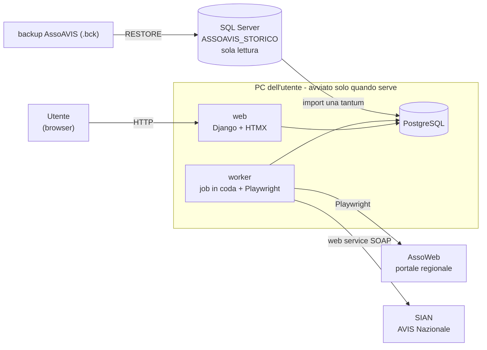
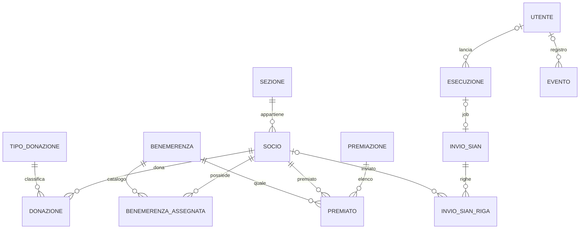

# Gestionale AVIS Altopiano di Asiago
Gestionale web per la sezione **AVIS Comunale Altopiano di Asiago** (sede 1529), estendibile ad altre sezioni. Sostituisce il vecchio gestionale desktop AssoAVIS 5, dismesso, e integra i dati del portale regionale **AssoWeb**.


## Indice

1. [Contesto e obiettivo](#1-contesto-e-obiettivo)
2. [Utenti e ruoli](#2-utenti-e-ruoli)
3. [Fonti dei dati e regole](#3-fonti-dei-dati-e-regole)
4. [Moduli](#4-moduli)
5. [Architettura](#5-architettura)
6. [Modello dati](#6-modello-dati)
7. [Sicurezza e GDPR](#7-sicurezza-e-gdpr)
8. [Test e verifica](#8-test-e-verifica)
9. [Installazione e avvio](#9-installazione-e-avvio)
10. [Struttura del repository](#10-struttura-del-repository)
11. [Limiti e sviluppi futuri](#11-limiti-e-sviluppi-futuri)

[Fonti](#fonti)

---

## 1. Contesto e obiettivo

Fino al 2025 la sezione inseriva a mano donatori e donazioni in **AssoAVIS 5**, un'applicazione desktop su SQL Server 2012 Express, ora dismessa. Dal 01/10/2026 i dati stanno nel portale regionale **AssoWeb** (`sit.azero.veneto.it/assoweb`). AssoWeb gestisce i donatori, ma non calcola quello che serve alla sezione come associazione:
- le **benemerenze**, cioè le premiazioni dei donatori al raggiungimento di un certo numero di donazioni;
- il **libro soci**, da inviare una volta all'anno al **SIAN**, il registro nazionale dei soci di AVIS Nazionale;
- le **statistiche** della sezione.

L'obiettivo è un gestionale web, usato dai volontari della sezione, che:
1. tiene in un unico database **PostgreSQL** lo storico di AssoAVIS e i dati aggiornati di AssoWeb;
2. automatizza le operazioni ripetitive sui portali esterni: **Playwright** per AssoWeb, che non ha API, e il **web service SOAP** per il SIAN;
3. calcola benemerenze, libro soci e statistiche.

**Vincoli:** dati personali e sanitari, quindi attenzione al GDPR; nessuna API per AssoWeb. Si sono privilegiate soluzioni semplici e funzionanti.

## 2. Utenti e ruoli

| Ruolo | Chi | Cosa può fare |
|---|---|---|
| **Volontario** | volontari della sede | consultare soci e statistiche, aggiornare i dati da AssoWeb, preparare una premiazione (senza assegnarla), inviare i posti liberi |
| **Amministratore** | presidente, segretario | tutto quello che fa il volontario, più: assegnare benemerenze, inviare il libro soci al SIAN, cambiare lo stato dei soci, gestire gli utenti |

I ruoli sono gruppi di Django, ricreati a ogni `migrate` da `gestionale/core/ruoli.py`.

## 3. Fonti dei dati e regole

**Chi comanda su cosa**

| Dato | Fonte "master" | Come entra nel DB |
|---|---|---|
| Anagrafica, contatti, tessera, gruppo sanguigno, idoneità | **AssoWeb** (`DONATORI_TOT.csv`) | sovrascritti a ogni import, solo con i valori non vuoti |
| Donazioni dal 01/01/2026 | **AssoWeb** (`TOT_DONAZIONI.csv`) | aggiunte a ogni import, mai cancellate |
| Donazioni fino al 2025, benemerenze e premiazioni storiche | **AssoAVIS** (backup `.bck`) | import **una tantum** da un ripristino in sola lettura |
| Stato del socio, iscrizione e cessazione, collaboratori | **Gestionale** | stato calcolato dopo ogni import; collaboratori segnati a mano |
| Premiazioni, invii SIAN, avvisi inviati | **Gestionale** | creati dall'applicativo |

**Aggancio tra le fonti**
- La chiave è il **codice fiscale**. Se manca o è sbagliato nello storico, si aggancia per cognome, nome e data di nascita, ma solo se il risultato è univoco: il CF di AssoWeb sostituisce quello dello storico e la correzione finisce nel report.
- Le donazioni sono univoche per **(socio, data)**: una donazione presente in entrambe le fonti si carica una volta sola.
- Il backup di AssoAVIS precede l'import regionale del 01/10/2026: AssoAVIS copre fino al 2025, AssoWeb dal 2026.
- Qualità dei dati (conteggi del 29/10/2026): nello storico 1.274 anagrafiche senza codice fiscale, 3 CF duplicati (reiscrizioni, fusi in un solo socio) e 10 totali pregressi negativi (correzioni manuali, importati con il segno). Dei 2.096 donatori di AssoWeb, 1.771 si agganciano per CF e altri 122 per nome.

**Stato del socio**
- Un campo di testo **senza storico**: *Socio donatore*, *Socio collaboratore*, *Ex socio*; vuoto = non ancora socio (per esempio un aspirante che non ha mai donato).
- Lo calcola `soci/stati.py` dopo ogni import, con la **regola dei 2 anni solari** già usata da AssoAVIS: chi ha donato nell'anno in corso o nei due precedenti è donatore; con l'ultima donazione nell'anno N si diventa ex socio il **31/12 dell'anno N+2** (causa 12). Verificata sullo storico: i 74 cessati al 31/12/2025 sono proprio quelli con l'ultima donazione nel 2023 o prima.
- Una cessazione decisa a mano (dimissioni, trasferimento) resta finché il socio non dona di nuovo.
- I **collaboratori** hanno una spunta separata dallo stato e non cessano mai: sono donatori finché donano, poi collaboratori.
- I codici di stato di AssoAVIS non si importano: tutti partono come ex soci e la funzione rimette donatori quelli attivi.

**Data di iscrizione**
- La base è la data di AssoAVIS, che però ha un segnaposto (31/12/1997) su metà delle anagrafiche e qualche data impossibile.
- Anche le date di AssoWeb hanno refusi (anno di nascita, minorenni, date del 2018 della migrazione regionale), quindi si prendono **solo quelle utili**: plausibili, non successive alla prima donazione e migliori di quella attuale (mancante, segnaposto o più recente).
- La data del portale si conserva sempre a parte e la regola si riapplica solo quando cambia: così le correzioni fatte a mano nel gestionale restano.

**Tessera**
- `TESSERA_ASSO` di AssoWeb è la stessa numerazione di AssoAVIS senza il codice della sede: `123` su AssoWeb è `152900123` in AssoAVIS. Coincidono per 1.248 soci su 1.263.
- L'import la scrive nel formato di AssoAVIS; non la prende, e la segnala come anomalia, se il formato non è previsto o se la tessera è già di un altro socio.

## 4. Moduli

### M1. Aggiorna dati
- Il bottone **Aggiorna dati** mette in coda un job: Playwright scarica da AssoWeb i due CSV (donatori e donazioni dell'anno), poi l'import li carica nel DB e ricalcola gli stati.
- L'import è **idempotente**: rieseguire lo stesso file non cambia nulla e non cancella mai niente.
- Il **report** dà i conteggi (soci nuovi e aggiornati, donazioni aggiunte) e le anomalie: CF corretti, residenze cambiate, tessere non importate, soci donatori non più presenti su AssoWeb, soci per cui AssoWeb conta più donazioni del DB. Le anomalie citano il socio con l'ID del DB, mai con nome o codice fiscale.
- Ogni esecuzione resta nello storico con utente, orari, esito e log.

### M2. Soci
- **Elenco** con ricerca (nome, CF, tessera, codici) e filtri per stato, idoneità e ultima donazione, aggiornati con HTMX.
- **Scheda socio:** anagrafica, contatti, dati trasfusionali, donazioni, benemerenze possedute e prossima benemerenza con quanto manca. Ogni apertura va nel registro eventi.
- Gli amministratori modificano solo i dati che decide il gestionale: stato, iscrizione, cessazione con causa, spunta collaboratore, "non desidera benemerenze", note. I dati di AssoWeb non si modificano qui, perché il prossimo import li sovrascriverebbe.

### M3. Statistiche
- Per anno: soci donatori per fascia d'età e sesso e per gruppo sanguigno; donazioni per tipo e per mese; movimento dei soci (nuovi, riammessi, cessati); soci per stato; andamento degli ultimi 10 anni.
- Lo stato non ha storico, quindi per gli anni conclusi i soci al 31/12 si ricostruiscono dalle donazioni con la regola dei 2 anni. Il risultato coincide con il libro soci SIAN: 517 soci nel 2025.
- Export Excel con un foglio per tabella. Barre in CSS, senza librerie di grafici.

### M4. Benemerenze
- **Catalogo** di 12 benemerenze, da Rame a Oro con Diamante. Le **regole** degli statuti 2004 e 2021 sono funzioni pure in `benemerenze/regole.py`, non una tabella, perché non cambiano:
  - **statuto 2004:** conta solo il numero di donazioni (8, 16, 24, 50, 75, 100);
  - **statuto 2021:** "donazioni + anni di iscrizione" oppure "solo donazioni", raddoppio "Donne x2" per le donazioni con emazie prima dei 50 anni, tetto annuo di donazioni valide (4 dal 2004 al 2020, 6 dal 2021) applicato dopo il raddoppio.
- **Chi si premia:** solo i donatori, cioè i soci donatori e gli ex soci cessati dopo l'ultima premiazione. Sono esclusi chi non desidera benemerenze e chi possiede già la benemerenza o una superiore.
- **Flusso di una premiazione:** bozza → calcolo degli aventi diritto → revisione (esclusioni con motivo, aggiunte a mano) → **assegnazione**, irreversibile e solo per gli amministratori → export Excel per la cerimonia.
- La correttezza del motore è verificata sulle 31 premiazioni storiche di AssoAVIS (§8).

### M5. Libro soci SIAN
- **Estrazione** del registro dell'anno aperto sul SIAN: i donatori con almeno una donazione negli ultimi due anni, i collaboratori e i cessati dell'anno, nel tracciato a 24 colonne. I controlli prima dell'invio elencano i record scartati con il motivo.
- **Invio con il web service SOAP** `RegistroSoci.asmx` del SIAN, la modalità prevista per i gestionali delle sedi, autenticato con il **token di cooperazione applicativa** generato dal Presidente sul portale. L'esito si legge socio per socio con `GetLogImportazione` e resta nello storico degli invii.
- L'invio completo **sostituisce l'intero registro della sede**: da qui in poi il gestionale è l'unica fonte del registro.
- **Ripiego:** export Excel nel formato del programma ufficiale *Uploader SIAN*.
- Il formato del campo `XML` della richiesta non ha documentazione pubblica: è stato ricostruito dal vecchio client di AssoAVIS e corretto con le prove (per esempio il sesso va inviato come numero, 1 o 2).

### M6. Posti liberi
- Quando una giornata di donazione ha molti posti liberi, l'operatore sceglie la giornata e il testo e conferma due volte. Un job Playwright usa la funzione *Ricerca e convocazione* di AssoWeb, che invia **SMS** ai donatori trovati da un filtro salvato sul portale.
- I destinatari li sceglie il filtro di AssoWeb, non il gestionale. Il job spunta i donatori di tutte le pagine dei risultati, invia e intercetta il banner di conferma del portale.
- Tre modalità: **invio**; **prova** con un filtro che trova solo l'operatore; **simulazione**, che si ferma su *Annulla* e dice quanti donatori riceverebbero l'SMS.
- Il percorso sul portale viene da una registrazione con `playwright codegen` fatta dall'utente con le proprie credenziali, che così non sono state condivise.

### Fuori ambito
- **Prenotazione via WhatsApp/LLM:** manca un modo di autenticare il donatore, chiunque potrebbe spacciarsi per un altro.
- **Promemoria** ai donatori che non donano da tempo: scartati dall'utente il 03/11/2026.
- Export nel formato di AVIS Nazionale: i dati si leggono dalla pagina delle statistiche.
- Convocazioni, agenda, esami, lettere ed etichette di AssoAVIS; interfaccia multi-sezione (il modello dati la prevede già).

## 5. Architettura



| Componente | Scelta | Motivo |
|---|---|---|
| Linguaggio | Python 3.14, ambiente gestito con **uv** | un solo linguaggio per web, import e automazioni |
| Web | **Django 5.2 LTS**, template lato server + **HTMX**, Bootstrap 5 con file statici locali | login, admin, ORM e migrazioni già pronti; nessun build JavaScript; nessuna dipendenza da CDN esterni |
| Database | **PostgreSQL 17** in Docker, solo su `127.0.0.1` | DB open al posto del SQL Server di AssoAVIS |
| Job in background | tabella `esecuzione` come coda + comando `manage.py worker` | un download Playwright dura minuti e non può girare in una richiesta web; la tabella è anche lo storico |
| Automazione AssoWeb | **Playwright** sincrono, con il browser visibile | il firewall di AssoWeb blocca il browser headless come bot |
| SIAN | client SOAP scritto con `urllib`, senza librerie | servono solo 4 operazioni |
| Export | ORM di Django e **openpyxl** | Excel per statistiche, premiazioni e Uploader SIAN |
| Test | **pytest** + pytest-django | 268 test su un DB PostgreSQL di prova |
| Avvio | `manage.py avvia`: PostgreSQL, migrazioni, web (**waitress**, file statici con WhiteNoise) e worker; con Ctrl+C backup e chiusura | il gestionale serve qualche volta all'anno e resta sul PC dell'utente |

Nella richiesta iniziale l'architettura ipotizzata era Django con frontend React. Si è scelto un monolite Django + HTMX: un solo progetto e un solo linguaggio, senza build JavaScript, sono più semplici da sviluppare e da mantenere.

**Scelte tecniche da notare nel codice**
- **Playwright e ORM in thread separati.** Dentro una sessione Playwright sincrona gira un event loop asyncio e Django rifiuta ogni accesso al DB (`SynchronousOnlyOperation`). Il codice dei portali (`portali/`) non usa mai l'ORM: il worker lo esegue in un thread separato (`core.worker.esegui_in_thread`) e scrive nel log i messaggi di avanzamento dal proprio thread.
- **Coda dei job sul DB.** Un job è una funzione `job(esecuzione, log)` registrata per tipo in `worker.JOB`; un solo worker per installazione. All'avvio il worker segna come fallite le esecuzioni rimaste a metà.
- **Lettura separata dalla scrittura negli import.** Gli import ricevono righe già lette, così si provano senza SQL Server e senza portale.
- **Nessun dato personale nei log e negli errori.** I soci si citano come `socio <id>`; gli errori dei portali riportano solo la prima riga del messaggio e uno screenshot salvato in locale.

**Struttura del codice (`gestionale/`)**

```
core/            sezioni, ruoli, coda dei job e worker, registro eventi, avvio e backup
soci/            soci, donazioni, stato del socio, elenco e scheda
importazioni/    import dei CSV di AssoWeb, migrazione dello storico AssoAVIS, unione dei doppioni
portali/         client Playwright di AssoWeb (login, download, SMS), client SOAP del SIAN
statistiche/     calcolo delle statistiche ed export Excel
benemerenze/     regole e motore di calcolo, premiazioni
sian/            estrazione del libro soci, controlli, export e invio
comunicazioni/   posti liberi
```

**Da dove iniziare a leggere:** `soci/models.py` e `soci/stati.py` (modello e regola dello stato), `importazioni/assoweb.py` (import e aggancio), `benemerenze/regole.py` (motore delle benemerenze), `core/worker.py` (job in background), `portali/assoweb.py` e `portali/sian.py` (integrazioni esterne), `sian/libro_soci.py` (estrazione del registro).

## 6. Modello dati



| Tabella | Contenuto | Note |
|---|---|---|
| `sezione` | codice (1529), nome, nome su AssoWeb | il nome serve per i filtri dei portali |
| `socio` | anagrafica, residenza e contatti, dati trasfusionali, idoneità, **stato**, spunta collaboratore, iscrizione, cessazione con causa, donazioni pregresse, codici di AssoAVIS e AssoWeb | una sola tabella per donatori, collaboratori ed ex soci; il CF è univoco ma può mancare |
| `donazione` | socio, data, tipo, centro di prelievo, fonte | univoca per (socio, data) |
| `tipo_donazione` | codice, descrizione, contiene emazie | 11 tipi; "contiene emazie" serve per la regola "Donne x2" |
| `benemerenza` | catalogo delle 12 benemerenze | le regole sono nel codice |
| `benemerenza_assegnata` | socio, benemerenza, data, fonte | ciò che il socio possiede |
| `premiazione`, `premiato` | premiazione con le sue date e lo stato; premiati con donazioni valide ed effettive | comprende le 31 premiazioni storiche |
| `esecuzione` | tipo di job, parametri, stato, log, utente, orari | coda dei job e storico; i posti liberi non hanno altre tabelle |
| `invio_sian`, `invio_sian_riga` | invio del libro soci e righe con operazione ed esito | esito socio per socio dal SIAN |
| `evento` | utente, azione, oggetto, IP, data e ora | registro degli accessi e delle operazioni (GDPR) |

Le donazioni pregresse senza data (inserite in AssoAVIS come totali) sono tre contatori sul socio e non righe di `donazione`.

## 7. Sicurezza e GDPR

I dati trattati sono personali e **sanitari** (donazioni, idoneità, gruppo sanguigno).
- **Rete:** web e PostgreSQL ascoltano solo su `127.0.0.1`, nessun altro PC li raggiunge. In uso l'applicazione gira con `DEBUG` spento; `manage.py check --deploy` segnala solo gli avvisi su HTTPS, non necessario perché il traffico non esce dal PC.
- **Accesso:** login obbligatorio su tutte le pagine (`LoginRequiredMiddleware`), due ruoli, password di almeno 10 caratteri, sessione che scade dopo 30 minuti di inattività o alla chiusura del browser.
- **Segreti:** credenziali di DB, AssoWeb e SIAN, token e `SECRET_KEY` stanno solo in `.env`, mai nel repository né nei log.
- **Registro eventi:** login (anche falliti), aperture delle schede, import, export, assegnazioni e invii. Senza dati sanitari.
- **Backup:** `pg_dump` a ogni chiusura del gestionale, con gli ultimi 10 conservati e una prova di ripristino (`manage.py ripristina --prova`) fatta il 03/11/2026. La cartella dei backup va su un supporto cifrato.
- **Minimizzazione:** i CSV scaricati restano solo fino all'import successivo; gli export si generano al momento.
- **Sviluppo:** le verifiche nel browser sul DB reale si sono fatte solo con conteggi e struttura delle pagine, senza leggere né fotografare dati personali.
- **A carico della sezione:** cifratura del disco del PC, registro dei trattamenti e nomina degli autorizzati.

## 8. Test e verifica

- **268 test automatici** (`pytest` + `pytest-django`, su un DB PostgreSQL di prova), tutti superati al 12/11/2026. Coprono il motore delle benemerenze e il flusso delle premiazioni, gli import (storico, CSV, unione dei doppioni), lo stato del socio, l'estrazione e l'invio del libro soci, le statistiche, il worker, i backup e le pagine con i permessi dei due ruoli.
- **Portali finti.** Il client Playwright si prova su `portali/assoweb_finto.html`, una copia finta di AssoWeb che riproduce solo i selettori usati; il web service del SIAN si sostituisce con risposte finte. Così i test non toccano mai i portali veri.
- **Regressione delle benemerenze** (`manage.py verifica_premiazioni`): ricalcola le 31 premiazioni storiche e confronta le donazioni dei premiati con quelle salvate da AssoAVIS. **Esito atteso:** dal 2007 le donazioni valide coincidono per tutti i premiati con le donazioni effettive uguali, tranne un socio a cui AssoWeb ha corretto il sesso; nel 2005–2006 (AssoAVIS non salvava le effettive) ne coincidono 131 su 146; la premiazione del 03/11/2025 è identica, 74 premiati su 74.
- **Prove sul campo**, con l'utente: download e import dal portale vero; invio di prova al SIAN su un solo socio prima dell'invio completo; SMS di prova all'operatore e simulazione sui 271 donatori del filtro prima dell'invio vero.

## 9. Installazione e avvio

**Prerequisiti:** Python 3.14 con [uv](https://docs.astral.sh/uv/), Docker (per PostgreSQL). Sviluppato e provato su Windows 11.

```bash
uv sync
```

```bash
uv run playwright install chromium
```

Copiare `.env.example` in `.env` e valorizzarlo: password del DB, `DJANGO_SECRET_KEY`, credenziali di AssoWeb e token del SIAN.

```bash
docker compose up -d db
```

```bash
uv run python manage.py migrate
```

```bash
uv run python manage.py createsuperuser
```

```bash
uv run python manage.py avvia
```

`avvia` apre il gestionale su `http://127.0.0.1:8000`; Ctrl+C aspetta i job attivi, chiude tutto e fa il backup. I test si lanciano con `uv run python -m pytest`, con il container `db` acceso.

**Comandi di gestione**

| Comando | Cosa fa |
|---|---|
| `avvia` | avvia DB, web e worker; alla chiusura fa il backup |
| `worker` | esegue i job in coda (in sviluppo, insieme a `runserver`) |
| `importa_assoavis` | import una tantum dello storico (serve SQL Server con il backup ripristinato e il gruppo di dipendenze `migrazione`) |
| `scarica_assoweb`, `importa_assoweb` | download dei CSV da AssoWeb e import, anche separati |
| `unisci_soci` | unisce alla scheda dello storico un doppione creato da AssoWeb (`--prova` per vedere l'esito senza salvare) |
| `verifica_premiazioni` | regressione del motore delle benemerenze |
| `backup`, `ripristina` | backup e ripristino del DB (`--prova` ripristina in un DB temporaneo) |

Senza lo storico e le credenziali dei portali il DB resta vuoto: i dati reali non sono nel repository (§10).

## 10. Struttura del repository

```
gestionale/          codice dell'applicativo (progetto Django e app, §5)
manage.py            comandi di Django e del gestionale
pyproject.toml       dipendenze (uv.lock le fissa)
docker-compose.yml   PostgreSQL, solo su 127.0.0.1
.env.example         modello della configurazione; il .env vero non è nel repository
ANALISI_ASSOAVIS.md  analisi tecnica di AssoAVIS 5: schema del DB, codifiche, regole delle benemerenze, tracciato SIAN
```

Non sono nel repository, perché contengono dati personali e sanitari reali o credenziali: il backup di AssoAVIS, i CSV scaricati, i backup del DB e il file `.env`. ANALISI_ASSOAVIS.md contiene solo schema e conteggi; la sua §9 (riuso del DB SQL Server) è superata: il gestionale usa un nuovo DB PostgreSQL.

## 11. Limiti e sviluppi futuri

- **Automazione di AssoWeb:** i test girano sulla copia finta del portale; se AssoWeb cambia interfaccia, il client va riprovato a mano sul portale vero.
- **Multi-sezione:** il modello dati la prevede, l'interfaccia no.
- **Rete locale:** se il gestionale dovesse tornare su un PC della sede raggiungibile in LAN servirebbe HTTPS (`DJANGO_HTTPS=1` dietro un reverse proxy).
- **Prenotazione via WhatsApp/LLM:** possibile solo con un sistema di autenticazione del donatore.

---

## Fonti
Il progetto è stato sviluppato con il supporto dell'assistente **Claude Code** (Anthropic) per la scrittura di codice, test e documentazione. Requisiti, scelte di progetto e prove sui portali reali sono dell'autore, che ha verificato il codice con i test automatici (§8).

- [`ANALISI_ASSOAVIS.md`](ANALISI_ASSOAVIS.md): analisi di AssoAVIS 5 e del suo database, 03/10/2026.
- AVIS Nazionale, manuale *Registro Nazionale Soci*, Ver.03 del 14/05/2025, dalla sezione *Manuali e Tutorial* del portale SIAN (consultato il 02/11/2026).
- AVIS Nazionale, manuale di *SianUploader*, Ver.06 del 05/03/2025, stessa sezione (consultato il 02/11/2026).
- WSDL del web service `https://sian.avis.it/sianws/RegistroSoci.asmx` (consultato il 02/11/2026).